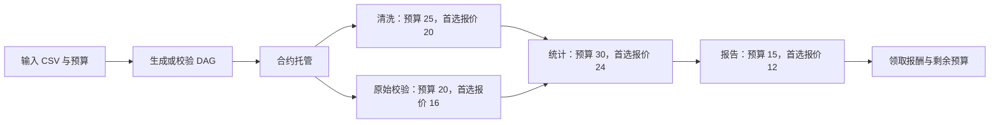
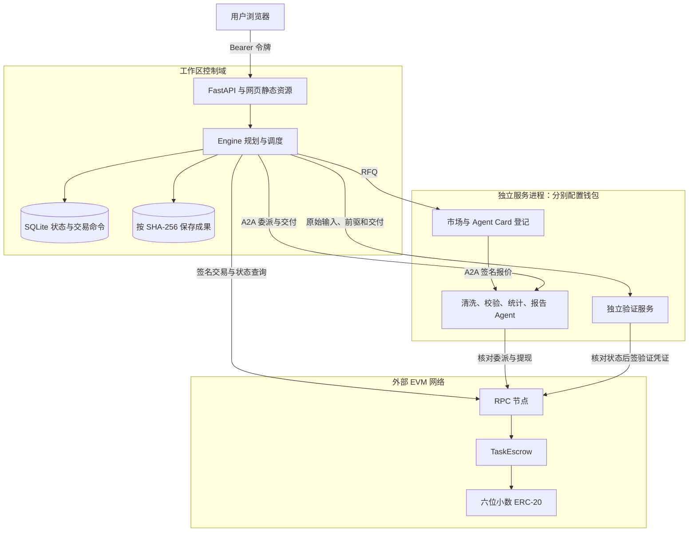
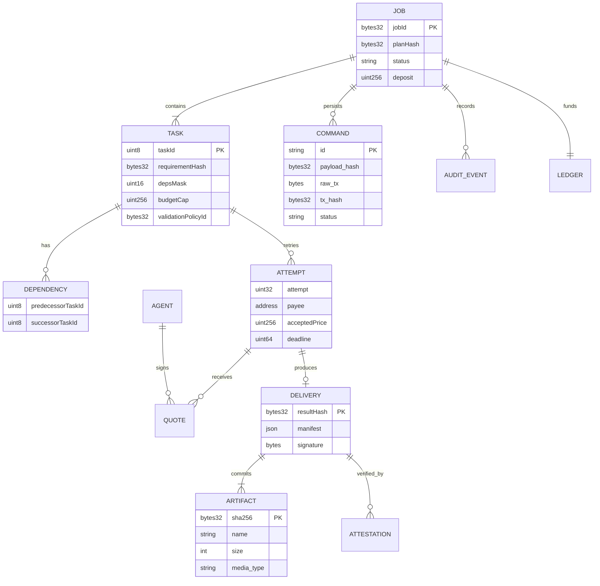
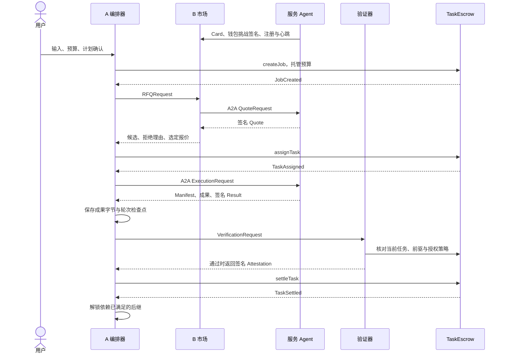
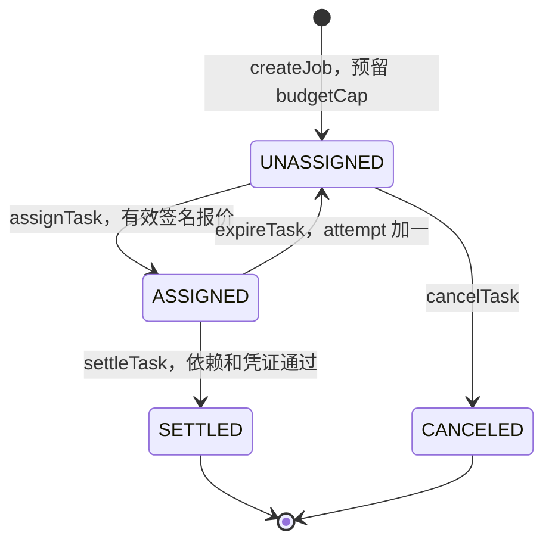
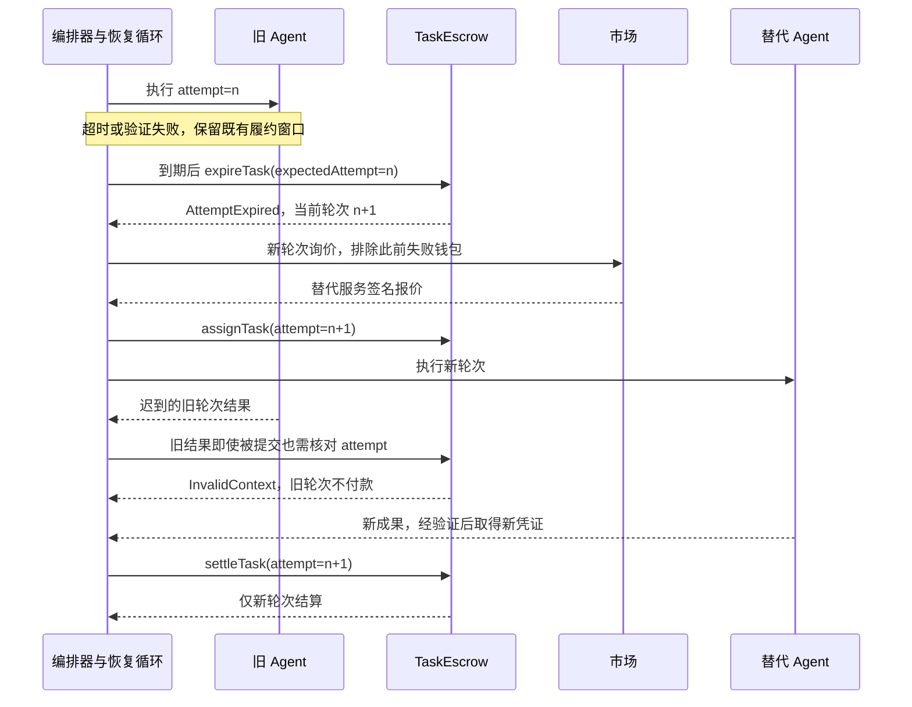

# CCFblock_chain · AgentFlow Pay（成员 A）

多智能体任务编排、服务交易和依赖感知结算。当前分支为 **A**，在此分支开发、提交和推送；暂不创建 PR、不合并到 main。其他成员分支不受本分支提交影响。

## 业务范围

平台将任务表示为带预算、依赖、时限和轮次上限的 DAG，发现并比较服务 Agent 的签名报价，按依赖委派，通过独立验证器核验实际成果，再提交合约结算。超时或履约失败时按策略重派；终态后领取报酬和未使用预算。

本版本包含确定性销售分析服务：数据清洗、原始数据校验、统计分析和报告生成。规划支持配置 DAG 与四节点模板，没有接入任意自然语言的大模型规划。API 支持不同合法 DAG；网页创建入口使用四节点模板。

这是单管理员工作区：管理员提供用户托管账户、协调者、验证者及服务商的签名配置，访问令牌授予该工作区的操作权限。尚未实现多租户用户登录和浏览器钱包签名。验证器可重算销售分析成果；合约信任指定验证者签名。链事件按固定区块头重扫并核对回执，不提供公链深度重组最终性的保证。

## 文件结构

根目录维护十个文件：

| 文件 | 用途 |
|---|---|
| app.py | 数据模型、DAG、服务发现、A2A、业务执行器、独立验证、协调与恢复、持久化、链适配和 API |
| manage.py | 安装、构建、导出接口、绑定现有合约、额度授权和启动服务 |
| web.tsx | 任务、服务市场、账本和成果网页，含样式 |
| TaskEscrow.sol | ERC-20 托管、依赖检查、签名验证、分轮结算、提现和退款 |
| project.json | 构建配置、固定依赖与可移植运行配置 |
| requirements.lock | Python 运行依赖 |
| pnpm-lock.yaml | 前端依赖锁 |
| README.md | 部署、接口和使用说明 |
| .gitignore | 排除环境、数据、密钥、缓存和测试产物 |
| AGENTS.md | A 分支协作及提交规则 |

源码与运行数据分离。依赖、构建结果、日志、SQLite 与部署记录写入 .cache；原始业务 CSV 默认放在 data。二者都不进入 Git。构建配置由 project.json 生成，不需要手动维护隐藏目录中的副本。

## 在 PyCharm 打开与启动

### 1. 获取工程与依赖

在 GitHub Desktop 克隆本仓库，Current Branch 选择 A。在 PyCharm 的 File → Open 中打开克隆出来的工程文件夹，不要求固定盘符、用户名或目录名。

环境要求：Python 3.12、Node.js 24、pnpm 11.25.0；编译使用 Foundry 1.8.5 与 Solidity 0.8.28。Node/pnpm 可通过系统 PATH 提供，或通过 AGENTFLOW_PNPM 指定 pnpm 可执行文件。Windows/Linux x64 的 setup 可安装固定版本 Forge；其他平台可预先将相应版本的 Forge 放到 PATH。

在 Run → Edit Configurations → + → Python 新建配置：脚本选择工程内 manage.py，工作目录选择工程根目录，解释器先选本机 Python 3.12。参数填 setup，点击运行。首次安装需要网络，完成后生成 .cache/venv 与前端/合约构建结果。以后解释器选项目中的 .cache/venv/Scripts/python.exe（Windows）或 .cache/venv/bin/python（Linux/macOS）。

克隆到新设备时重新执行 setup，不能把旧设备的 venv 或 node_modules 当作可移植源码复制过去。

### 2. 配置链、账户与业务数据

服务连接外部运营的 EVM RPC。由合约负责人先部署一个 **6 位小数 ERC-20** 和以它为构造参数的 TaskEscrow；本仓库不自动启动模拟链、不生成钱包、不铸造代币。账户余额、Gas 和合约地址由部署环境提供。

编辑 project.json 的 runtime 区域，或新建被 Git 忽略的 runtime.json，并在运行参数后添加 `--config runtime.json`。独立 runtime.json 直接使用 runtime 区域内的结构。文件路径均相对配置文件目录解析；默认配置文件相对工程根目录定位，与启动时的终端目录无关。

| 配置 | 含义 |
|---|---|
| directory | 运行记录目录，默认 .cache/runtime |
| inputDirectory | 业务 CSV 目录，默认 data |
| api / market / validator | 各服务公开访问地址 |
| bind | 当前机器服务监听地址，默认 127.0.0.1 |
| chain.startBlock | 合约部署区块，避免每次从创世区块扫描 |
| chain.tokenSymbol | 支付代币展示名称 |
| agents | 服务 ID、地址、技能报价及密钥环境变量名称 |
| allowedAgentOrigins（可选） | 市场允许注册的 Agent 地址白名单；默认取 agents 的地址 |

默认地址适合全部服务位于同一主机。分别部署时可单独运行 app.py，参数 `--config runtime.json --role api`（或 market、validator、配置中的服务 ID），使用对应主机的 bind 与可达服务地址。HTTPS 公开地址需要部署环境提供 TLS 反向代理。

在 PyCharm 运行配置的 Environment variables 中填写环境变量，保留原有变量。配置文件只存变量名称，不存私钥：

| 环境变量 | 值来源 |
|---|---|
| AGENTFLOW_API_TOKEN | 管理员设置的至少 32 字符访问令牌 |
| AGENTFLOW_RPC_URL | EVM RPC 地址 |
| AGENTFLOW_CHAIN_ID | 对应链 ID，十进制 |
| AGENTFLOW_TOKEN_ADDRESS | 已部署的六位小数 ERC-20 地址 |
| AGENTFLOW_ESCROW_ADDRESS | 已部署 TaskEscrow 地址 |
| AGENTFLOW_OWNER_KEY | 托管预算账户私钥 |
| AGENTFLOW_COORDINATOR_KEY | 协调者私钥 |
| AGENTFLOW_VALIDATOR_KEY | 独立验证者私钥 |
| AGENTFLOW_CLEAN_A_KEY / AGENTFLOW_CLEAN_B_KEY | 两个清洗服务私钥 |
| AGENTFLOW_QUALITY_A_KEY | 原始数据校验服务私钥 |
| AGENTFLOW_STATS_A_KEY / AGENTFLOW_STATS_B_KEY | 两个统计服务私钥 |
| AGENTFLOW_REPORT_A_KEY | 报告服务私钥 |

各角色使用独立账户。外部单服务进程只加载该角色需要的签名密钥；整体启动器需要全部所管理服务的配置。默认配置不包含任何可使用的密钥或真实账户地址。

将实际销售 CSV 放入 data，UTF-8 编码，列名和顺序为：

```text
organization,order_id,date,category,quantity,unit_price_cents
```

文件按文件名排序读取。日期采用 YYYY-MM-DD，category 支持 book、food、tool，数量和单价分值是整数；清洗和原始校验负责记录无效行与重复记录。单文件上限 20 MB，至少一份 CSV。输入内容哈希冻结在计划中，执行和验证均核对原始字节。

### 3. 绑定、授权、启动

沿用同一个 PyCharm 配置及环境变量，依次更改 manage.py 的参数并运行：

| 参数 | 效果 |
|---|---|
| configure | 核对链 ID、代币精度、合约地址/代币绑定及角色钱包，将部署身份保存到运行目录；不发送交易 |
| approve --amount 100 | 由 owner 给托管合约授权明确额度 100，发送一笔代币授权交易；额度可按需要调整 |
| start | 启动市场、验证器、配置中的业务 Agent 和 API，输出网页地址，持续运行 |

configure 在已有运行目录中拒绝更换链、合约、字节码和角色身份。切换部署请同时使用新的 directory，避免混用旧账本。approve 的额度需要覆盖待创建任务预算；未设置余额、Gas 或授权时创建交易会失败。

最后把参数保留为 start，配置命名为“AgentFlow”，以后直接点绿色三角。默认不填参数也执行 start。若使用独立配置，以上每一项都带上同一个 `--config runtime.json`。

网页出现后，用 AGENTFLOW_API_TOKEN 的值登录。服务一直运行是正常状态；完成后在 PyCharm 点停止。没有使用终端的必要，以上参数都是填写到运行配置的“脚本参数”栏。

## 网页操作与业务流程

服务市场查看已注册服务与报价能力。点击“创建分析任务”，检查输入数据、总预算和节点预算后确认。清洗和原始校验并行，二者结算后统计开始，统计结算后生成报告。API 可提交包含最多 16 个节点的合法配置计划。



各节点执行发现、签名报价检查、选择、委派、成果交付、独立验证和链上结算。依赖只有在链上结算且前驱成果可用后才满足。超时按合约时限推进轮次并重派；耗尽轮次或不可恢复的依赖失败取消后继。停止新委派保留已接受服务的履约窗口。

资金账本区分已确认报酬与实际提现。点击“领取报酬与退款”完成可领取资金转账；重复点击不会重复支付同一笔余额。成果页按任务和轮次展示可下载内容及结算状态，旧轮次成果不能用于新轮次结算。

默认四节点预算上限为 25/20/30/15，总上限 90；默认首选报价 20/16/24/12，总成交额 72。最终金额以选中的有效报价和实际履约为准。换用备用 Agent 时费用可变化。

## 业务接口

业务接口使用 `Authorization: Bearer <访问令牌>`；health 和静态页面可直接访问。

| 接口 | 用途 |
|---|---|
| GET /api/config、/api/inputs | 公开业务配置、输入元信息，不返回密钥 |
| GET /api/plans/schema、/api/runtime/schema、/api/protocol/schema | 计划、运行态及服务消息 Schema |
| POST /api/plans/preview | 校验预算、依赖、类型和输入绑定 |
| POST /api/jobs | 创建任务，支持 requestId 幂等及显式 plan |
| GET /api/jobs、/api/jobs/{id} | 任务列表及 DAG/资金快照 |
| POST /api/jobs/{id}/stop、/resume | 停止后续委派、恢复协调 |
| GET /api/jobs/{id}/quotes、/audit、/events | 报价、审计、支持 Last-Event-ID 的 SSE |
| GET /api/jobs/{id}/settlements | 合约状态及链事件 |
| POST /api/jobs/{id}/claims | 领取已结算报酬与退款 |
| GET /api/jobs/{id}/artifacts、/artifacts/{hash} | 成果列表及按内容哈希下载 |
| GET /api/agents；POST /api/agents/register | 服务列表与注册转发 |

Agent 使用 A2A 1.0 JSON-RPC，Agent Card 位于 /.well-known/agent-card.json。注册采用端点白名单、钱包挑战签名和租约心跳。交易命令与签名交易先落库，重启后按原交易哈希恢复；API 状态以链上事实协调。

## 可迁移性与提交规则

源码不引用个人目录、固定安装路径或随源码携带的虚拟环境。工程根目录由脚本位置确定；输入/运行目录相对配置文件确定；构建目录默认 .cache，可通过 AGENTFLOW_BUILD_DIR 覆盖。

在新设备上克隆 A、安装依赖、提供对应链和账户配置、放入业务输入即可启动。同一部署的数据迁移应停止服务后复制运行目录和业务输入，再在新设备重新安装依赖；历史运行记录不提交到 Git。

GitHub Desktop 中始终选择 A → Commit → Push origin。不要选择 Publish/PR/Merge 到 main；只有用户后续明确授权才进入团队审核合并流程。提交前按 .gitignore 和 AGENTS.md 排除测试、缓存、IDE 配置、密钥与数据。

## 系统分析与设计

以下按《第三版.md》的十二章要求整理整个系统。A 负责本稿与编排实现；涉及 B 的市场/A2A、C 的合约/安全和 D 的前端/实验部分，是对当前 A 分支实现的分析，仍需对应成员确认。图中的组件是逻辑模块与服务进程，不要求拆成更多源码文件。

### 1. 应用背景与意义

跨组织销售分析需要不同服务完成清洗、质量核对、统计与报告。后续节点必须使用已认可的前驱成果；失败后更换执行者还涉及旧委派作废、预算复用和报酬归属。单个任务的托管记录不足以表达这些关系。

平台以任务图组织履约，以 DASC（依赖感知安全结算）约束付款。链下负责发现、选择、计算和内容验证；链上保存付款所需的承诺、依赖和轮次。当前适用于可按确定性规则核验的数据分析，不承诺处理任意自然语言任务或主观质量争议。

### 2. 问题、参与者与需求

用户在当前实现中由工作区 owner 账户代表；协调者负责拆分与调度；市场负责登记、发现和报价比较；服务 Agent 执行任务并签名；验证者核对成果；合约执行资金与状态约束。网页操作者持有工作区访问令牌。

| 需求 | 优先级 | 具体行为与验收目标 |
|---|---|---|
| R-01 计划建模 | P0 | 1～16 个节点；拒绝环、缺失依赖、重复节点、超预算和输入输出类型不匹配 |
| R-02 服务交易 | P0 | 通过 Agent Card 和钱包挑战注册；按技能询价，拒绝无效签名、过期或不匹配报价 |
| R-03 协作编排 | P0 | 同批就绪节点并发；前驱链上已结算且成果可用后才执行后继 |
| R-04 恢复 | P0 | 到期推进 attempt，排除失败钱包重新询价；耗尽轮次取消节点并处理受阻后继 |
| R-05 成果验证 | P0 | 验证输入来源、结果字节、任务上下文及业务规则；不把签名有效等同于内容正确 |
| R-06 资金结算 | P0 | 预算托管、按节点记账、收款人主动提现、终态退款；重复请求不增加支付 |
| R-07 可观察性 | P0 | 持久化计划、报价、轮次、成果、交易与审计；网页可查看和下载 |
| R-08 可迁移交付 | P0 | 源码与本机路径无关；环境、输入和密钥由部署配置提供 |
| R-09 跨场景复用 | P1 | 旅游等场景须补齐执行器和验证规则后单独验收；当前未实现 |

威胁包括服务冒名、报价改价、跨任务/链/合约重放、旧轮次交付、前驱替换、错误成果、依赖绕过、重复支付，以及进程或 RPC 中断。假设 EVM、基础密码学和所配置 RPC 按预期工作；恶意授权验证者和持有工作区令牌的攻击者属于仍需治理的风险。

### 3. 设计目标与组合约束

| 约束 | 当前实现位置 | 保证边界 |
|---|---|---|
| S1 身份 | Market 注册挑战、Quote/Result 验签、Task.payee | 钱包、报价者和收款人绑定；不证明真实组织身份 |
| S2 报价 | Quote 全字段签名、EIP-712 域、nonce 与有效期 | 价格、任务、链和合约上下文不可随意替换 |
| S3 依赖 | Engine 就绪检查；settleTask 的 depsMask/settledMask | 编排器限制执行顺序，合约独立限制结算顺序 |
| S4 轮次 | expireTask、attempt、结果与验证签名 | 到期后的旧轮次不能用于当前轮次结算 |
| S5 资金 | Job 预算账本、终态、credits、pull payment | 每节点只结算一次，付款不超过成交价与预算 |
| S6 凭证 | 指定 validator、policyId、resultHash、attestationNonce | 只有授权验证签名可驱动付款；签名者仍可能作恶 |

设计重点是把任务依赖、执行轮次、内容承诺与资金账本一起检查。与仅有独立托管单的方式相比，后继付款必须受前驱结算状态约束，替换执行者也必须让旧轮次失效。本稿不将这些工程组合表述为已证明的新型共识或通用去信任计算协议。

### 4. 总体架构、部署与数据模型



默认同机多进程部署：API 8080、市场 8081、验证器 8082、六个 Agent 8090～8095。地址与监听网卡均可配置，各服务可独立启动；外部分机部署需要可达 RPC、服务地址、部署记录及 TLS 设施。独立钱包与独立进程提供职责隔离，当前共同管理员和共享访问令牌尚不构成组织间的强权限隔离。

下图是逻辑数据模型。链下实际使用 SQLite 的 records（bucket/key/value）、events（递增序号）和 commands（原始交易与回执）三类存储；并非每个逻辑实体都建独立 SQL 表。



Task 的完整身份是 `(jobId, taskId)`，Attempt 是 `(jobId, taskId, attempt)`；图中 taskId 是 Job 内索引。taskId 按计划拓扑顺序分配，业务节点名保留在 TaskSpec.key。DEPENDENCY 的 predecessorTaskId 也引用同一 Job 内的 Task。Manifest 绑定输入引用、前驱的 taskId/attempt/resultHash、成果引用和任务身份；resultHash 是规范化 Manifest 的 SHA-256。链上仅保留哈希与结算字段，CSV、报告和完整 Manifest 留在链下。

### 5. 核心协议与接口交接

接口版本为 1，交接状态为 `local_proposal`，表示 A 已实现的接口提案，尚未由 B/C/D 联合冻结。在 PyCharm 的 manage.py 运行配置中把参数改为 `schema` 即可离线导出 `.cache/interfaces.json`，无需 RPC、账户或启动服务；导出后将参数改回 `start`。需要其他输出位置时填写 `schema --output 相对目录/文件.json`。同一内容也可通过已登录 API 的 Schema 接口获取。

导出包包含 Plan、Job/Task 运行态、审计事件与 11 个服务消息模型。它由实际 Pydantic 模型生成；EIP-712 消息字段由同一份 FIELDS 定义生成，避免手写副本漂移。JSON Schema 约束字段、类型与范围；跨字段、依赖顺序、内容哈希、业务真实性和链上授权还需运行时检查。

| 调用方 → 接收方 | 入口 | 请求模型 | 响应模型 | 失败约定 |
|---|---|---|---|---|
| A → B 市场 | POST /api/rfq | RFQRequest | RFQReply | 消息/上下文非法返回 HTTP 400；无有效报价时 selected=null |
| B → 服务 Agent | A2A SendMessage，operation=quote | QuoteRequest | QuoteReply | A2A FAILED Task，失败原因写入 message |
| A → 服务 Agent | A2A SendMessage，operation=execute | ExecutionRequest | ServiceDelivery | A2A FAILED 或传输异常，由协调者进入恢复处理 |
| A → 验证器 | POST /verify | VerificationRequest | VerificationReply | 拒绝为 passed=false、reason；不含可付款签名 |
| D → A | GET /api/protocol/schema | 无 | 协议模型集合 | 无令牌 HTTP 401 |

RFQRequest 包含 jobId、taskId、attempt、plan、idempotencyKey、excludeWallets。ExecutionRequest 另外包含输入字节包与有序 upstreamRefs；VerificationRequest 包含 plan、实际输入、前驱交付和当前交付，当前 attempt 从交付中取出。ServiceDelivery 返回 manifest、artifacts、签名 Result；验证成功响应返回 checks、签名 Attestation。候选列表保留拒绝原因，selected 必须属于有效候选。

金额对外有两种明确单位：Plan 的 deposit/budget_cap 是最多六位小数的代币金额字符串；签名报价与链上账本是最小单位整数的十进制字符串，1 个代币等于 1,000,000 最小单位。uint64/uint256 在线上传字符串，uint8/uint32 使用 JSON 整数；禁止浮点金额。deadline、validUntil、submittedAt 使用 Unix 秒。业务 taskId/attempt 从 0 开始；A2A task.id 是单独的传输任务标识，不能混用。

签名域为 `name=DASC, version=1, chainId=部署链, verifyingContract=TaskEscrow 地址`。Quote 签价格、需求哈希、支付代币、任务/轮次、钱包、有效期和 nonce；Result 签任务/轮次、钱包、结果哈希、URI 哈希和提交时间；Attestation 签任务/轮次、结果哈希、策略 ID、判定、有效期和 nonce。完整字段类型及顺序见导出包 signedFields，与 TaskEscrow.sol 的类型声明一致。

创建任务使用 requestId：相同 owner/链/合约/requestId 对应同一 jobId，计划不同则拒绝。执行请求键为 `execute:jobId:taskId:attempt`；Agent 保存请求哈希和响应，同键不同内容拒绝。RFQ 是一次询价批次的标识，重新询价使用新键，不能把过期报价当永久缓存。发送链交易前持久化命令及签名交易；重启按交易哈希恢复，避免盲目重复创建新交易。

| 合约函数 | 角色与主要前置条件 | 事件/效果 |
|---|---|---|
| createJob | owner 转入代币；合法拓扑、预算和截止时间 | JobCreated；逐节点预留预算 |
| assignTask | coordinator；有效报价、当前轮次和预算 | TaskAssigned；固定 payee、price、deadline |
| settleTask | owner/coordinator；成果与验证签名、期限、轮次及依赖通过 | TaskSettled；增加服务商可提现余额 |
| expireTask | 任何调用者；已分配、已到期、expectedAttempt 匹配 | AttemptExpired；轮次递增、回到未分配 |
| requestStop | owner；尚未终结 | StopRequested；禁止新委派 |
| cancelTask | 未分配节点；owner/coordinator，或满足公开取消条件 | TaskCanceled；释放预留预算 |
| finalizeJob | 任何调用者；全部节点进入结算/取消终态 | JobFinalized；未用预算转为退款余额 |
| withdraw / claimRefund | 有余额的服务商 / owner | Withdrawn / Refunded；实际转账并清零对应余额 |

公开取消条件为 Job 已过总期限或存在已取消的依赖。具体失败由 InvalidState、InvalidContext、Expired、DependenciesUnsettled、BudgetExceeded、InvalidSignature、NonceUsed 等合约错误表示。A 的 RuntimeFault 另外记录 phase、code、action 和 message；HTTP 失败、业务拒绝与交易回滚不可互相冒充。

### 6. 多 Agent 自主协作

规划器先验证 DAG、金额和类型，再按拓扑序产生节点索引及依赖位图。市场从在线租约中筛选技能，读取 Agent Card，通过钱包挑战绑定端点；A2A 报价由服务钱包签名。默认选有效报价中的最低价；相同评分按 agentId 排序。可选 risk_aware 用链上已结算/到期记录加风险惩罚，采用整数和有理数运算；它是启发式选择策略，不能解释成准确的成功概率预测。



调度循环先恢复待确认交易并重读链状态，再处理到期/终态节点、取消受阻后继，最后并发推进当前就绪批次。当前使用 asyncio.gather 等待一批完成后重新调度；因此不承诺完全按单节点完成事件立即推进所有后继。配置支持 sequential 与 dag 两种策略，便于在相同条件下比较。

### 7. 成果验证与信任模型

| 服务 | 独立验证器核对内容 | 防止的典型问题 |
|---|---|---|
| 清洗 | 从原始 CSV 重建合法行和去重结果 | 漏行、改值、替换输入、伪造清洗报告 |
| 原始校验 | 独立核对缺失值、格式、重复与数量 | 校验报告与实际数据不符 |
| 统计 | 重算季度计数、收入、类别统计及精确均值 | 统计结果格式正确但数值错误 |
| 报告 | 固定章节、统计引用、来源和季度图表 | 报告/图表与已结算统计不一致 |

验证同时核对 inputRefs、upstreamRefs、文件字节哈希、Manifest、链上需求与策略哈希。策略 ID 包含固定规则及验证代码承诺，修改验证实现需要按新的策略重新建立计划，不能悄悄改变已有付款条件。

服务协议模型只做格式和承诺一致性检查，验证器仍要重新计算业务内容；合约最终检查授权签名和上下文。当前验证者由部署配置固定。若该验证者故意给错误内容签署通过凭证，链上无法自行复算 CSV 并识别谎言；多验证者、争议仲裁、隐私计算均未实现。

### 8. 业务场景与复用边界

主场景是跨组织销售分析，流程和预算见前文 DAG。原始 CSV 顺序、文件哈希、去重规则和整数分值运算固定，使清洗、校验、统计和报告能够独立复核。默认六个服务实例覆盖四种技能，其中清洗和统计各有两个报价方。

配置 DAG 可复用相同执行器，构建具有多个统计/报告输出的六节点任务图；它验证编排器不是仅支持一条写死的四节点路径。输入输出类型和技能仍受当前销售分析规则约束。旅游场景属于 P1，需要新增技能、输入/输出契约和可执行验证规则，当前没有完成旅游 E2E，也没有任意目标自动分解功能。

### 9. 功能、指标与验收追踪

下表描述应怎样验收。代码存在、单机验证通过、跨成员联调完成是不同状态；本分支的验证不能代替团队联合验收。测试脚本与原始证据按用户要求保留在本地忽略目录，不进入业务源码仓库。

| Req | 实现定位 | 验收方法与通过条件 | 当前边界 |
|---|---|---|---|
| R-01 | app.py：Plan、prepare_plan、validate_skills | 非法图/预算/类型拒绝，四/六节点合法图均能执行 | 已实现确定性模板与配置 DAG |
| R-02 | app.py：Market、ServiceExecutor、a2a_call | 合法询价保留竞争候选；错字段、假签名和失效报价拒绝 | 需 B 确认注册与协议兼容 |
| R-03 | app.py：Engine.run/execute_node | 首层两节点执行，后继等前驱结算；多输出完整产出 | 当前按就绪批次调度 |
| R-04 | app.py：expire、recover_commands、API lifespan | 到期重派、旧轮次拒绝、重启继续、耗尽后退款 | 完整故障矩阵与 C/D 联验待完成 |
| R-05 | app.py：check_context、validate_delivery、verify_content | 修改输入、结果、统计或图表后不能获得有效付款凭证 | 仅支持已定义销售分析规则 |
| R-06 | TaskEscrow.sol；app.py：Chain、claims | 默认成功支付 72、退回 28；重复领取账本不变 | 需 C 确认合约安全矩阵与不变量证据 |
| R-07 | app.py：Database/ArtifactStore/API；web.tsx | 网页状态与链状态一致，审计可续读、成果可下载 | D 的跨浏览器/断线联合验收待完成 |
| R-08 | manage.py、settings_file、project.json | 新路径、不同工作目录启动；schema 不依赖链或密钥 | 新设备仍需安装运行环境和提供部署配置 |
| R-09 | 尚无旅游执行器 | 完整旅游输入到成果、验证、付款另行验收 | P1 未完成 |

实验统计按《第三版.md》保留四组：完整协议与简化托管的安全对照、终止与重派的恢复对照、串行与 DAG 的调度对照、最低价与风险评分的选择对照。使用同一数据、预算、服务候选及故障条件，记录实际启动 Job 数；失败和超时也计入分母。


任务完成率为全必需节点成功的 Job 数/实际启动 Job 数；端到端耗时从用户请求开始到 Job 终态，成功与失败分别统计。恢复耗时从故障被记录到替代轮次结算；Gas 从实际回执汇总。并行收益与风险评分收益必须来自重复对照实验，不能用本地一次成功运行推导。目前未在本稿填入未经测量的性能或安全通过率。

### 10. 状态与异常恢复



链上只有上述四种 Task 状态。链下额外记录 BIDDING、ASSIGNING、RUNNING、VERIFYING、SETTLING、RECOVERING 等操作进度；这些进度不能覆盖链上已确认状态。结算将 budgetCap 从 reserved 移出，将 acceptedPrice 记入 agentCredits、差额记入 unallocated；取消将整笔 cap 移入 unallocated。所有节点终态后，finalizeJob 将 unallocated 转入 refundCredit；提现/退款才真正转出代币。



无有效报价连续达到三次时取消未分配节点。已分配节点发生网络/验证错误时，等待截止时间后推进轮次；次数用尽、任务总期限不足或依赖已取消时取消受影响节点。原始成功前驱继续保留。RPC 暂时不可达意味着链状态未知，不据此认定交易失败；恢复后核对回执和事件再继续。

用户“停止”会在链上设置 stopping，禁止新委派；已接受的服务保留履约窗口。“恢复”只重新启动协调工作，不撤销链上 stopping，也不复活已终结任务。此区别应在团队 UI 验收时明确。

### 11. 可靠性、安全与成本

每个 Job 的账本不变量是：

```text
deposit = reserved + unallocated + agentCredits + refundCredit + withdrawn + refunded
```

totalLiability 表示尚留在合约内的应付责任；正常入出金下应等于所有 Job 未转出部分之和。合约代币余额至少覆盖该值；第三方直接转入的额外代币不能当成某 Job 的余额。节点结算/取消不可重复，旧 attempt、已用 nonce、未满足依赖和超预算支付必须拒绝。

交易 outbox、签名原文和回执用于恢复；成果先持久化再验证/结算，避免成功付款后丢失后继输入。链事件按固定区块头扫描并检查区块哈希，不能保证公链深度重组下的最终性。当前单协调者、SQLite、整段事件重扫和内联 base64 成果适合比赛规模；多实例调度、长期链索引、大文件流式传输与高可用尚需进一步设计。

服务发现使用端点白名单，减少把访问令牌发往未知端点的风险。当前工作区令牌权限较大、私钥通过进程环境提供，仍需运营方控制主机和日志访问。协议签名证明钱包授权和承诺，无法证明服务无抄袭、验证者诚实或市场定价公平。

### 12. 完成边界与后续工作

A 分支已有可配置 DAG、市场询价与签名校验、真实 A2A 任务交付、独立内容核验、合约结算、恢复与持久化、网页/API 和可移植部署配置。本次补充服务消息模型、运行时校验、离线接口导出，以及整体系统的架构、数据模型、时序、状态、恢复与实验证据流程图。

接口文件仍是 A 提案。后续由 B 确认 Card/RFQ/A2A 与钱包绑定，由 C 确认 TypedData/ABI、取消语义和资金不变量，由 D 确认网页字段、故障展示和实验记录，再完成共同部署的联调验收。SEC-01～SEC-30、四组正式对照实验、旅游 P1、多租户与争议处理没有在本稿宣称完成。
