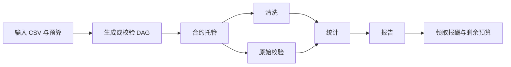

# CCFblock_chain · AgentFlow Pay（成员 A）

多智能体任务编排、服务交易和依赖感知结算。当前分支为 **A**，在此分支开发、提交和推送；暂不创建 PR、不合并到 main。其他成员分支不受本分支提交影响。

## 业务范围

平台将任务表示为带预算、依赖、时限和轮次上限的 DAG，发现并比较服务 Agent 的签名报价，按依赖委派，通过独立验证器核验实际成果，再提交合约结算。超时或履约失败时按策略重派；终态后领取报酬和未使用预算。

本版本包含确定性销售分析服务：数据清洗、原始数据校验、统计分析和报告生成。规划支持配置 DAG 与四节点模板，没有接入任意自然语言的大模型规划。API 支持不同合法 DAG；网页创建入口使用四节点模板。

这是单管理员工作区：管理员提供用户托管账户、协调者、验证者及服务商的签名配置，访问令牌授予该工作区的操作权限。尚未实现多租户用户登录和浏览器钱包签名。验证器可重算销售分析成果；合约信任指定验证者签名。链事件按固定区块头重扫并核对回执，不提供公链深度重组最终性的保证。

## 文件结构

根目录维护十个文件：

| 文件 | 用途 |
|---|---|
| app.py | 数据模型、DAG、服务发现、A2A、业务执行器、独立验证、协调与恢复、持久化、链适配和 API |
| manage.py | 安装、构建、绑定现有合约、额度授权和启动服务 |
| web.tsx | 任务、服务市场、账本和成果网页，含样式 |
| TaskEscrow.sol | ERC-20 托管、依赖检查、签名验证、分轮结算、提现和退款 |
| project.json | 构建配置、固定依赖与可移植运行配置 |
| requirements.lock | Python 运行依赖 |
| pnpm-lock.yaml | 前端依赖锁 |
| README.md | 部署、接口和使用说明 |
| .gitignore | 排除环境、数据、密钥、缓存和测试产物 |
| AGENTS.md | A 分支协作及提交规则 |

源码与运行数据分离。依赖、构建结果、日志、SQLite 与部署记录写入 .cache；原始业务 CSV 默认放在 data。二者都不进入 Git。构建配置由 project.json 生成，不需要手动维护隐藏目录中的副本。

## 在 PyCharm 打开与启动

### 1. 获取工程与依赖

在 GitHub Desktop 克隆本仓库，Current Branch 选择 A。在 PyCharm 的 File → Open 中打开克隆出来的工程文件夹，不要求固定盘符、用户名或目录名。

环境要求：Python 3.12、Node.js 24、pnpm 11.25.0；编译使用 Foundry 1.8.5 与 Solidity 0.8.28。Node/pnpm 可通过系统 PATH 提供，或通过 AGENTFLOW_PNPM 指定 pnpm 可执行文件。Windows/Linux x64 的 setup 可安装固定版本 Forge；其他平台可预先将相应版本的 Forge 放到 PATH。

在 Run → Edit Configurations → + → Python 新建配置：脚本选择工程内 manage.py，工作目录选择工程根目录，解释器先选本机 Python 3.12。参数填 setup，点击运行。首次安装需要网络，完成后生成 .cache/venv 与前端/合约构建结果。以后解释器选项目中的 .cache/venv/Scripts/python.exe（Windows）或 .cache/venv/bin/python（Linux/macOS）。

克隆到新设备时重新执行 setup，不能把旧设备的 venv 或 node_modules 当作可移植源码复制过去。

### 2. 配置链、账户与业务数据

服务连接外部运营的 EVM RPC。由合约负责人先部署一个 **6 位小数 ERC-20** 和以它为构造参数的 TaskEscrow；本仓库不自动启动模拟链、不生成钱包、不铸造代币。账户余额、Gas 和合约地址由部署环境提供。

编辑 project.json 的 runtime 区域，或新建被 Git 忽略的 runtime.json，并在运行参数后添加 `--config runtime.json`。独立 runtime.json 直接使用 runtime 区域内的结构。文件路径均相对配置文件目录解析；默认配置文件相对工程根目录定位，与启动时的终端目录无关。

| 配置 | 含义 |
|---|---|
| directory | 运行记录目录，默认 .cache/runtime |
| inputDirectory | 业务 CSV 目录，默认 data |
| api / market / validator | 各服务公开访问地址 |
| bind | 当前机器服务监听地址，默认 127.0.0.1 |
| chain.startBlock | 合约部署区块，避免每次从创世区块扫描 |
| chain.tokenSymbol | 支付代币展示名称 |
| agents | 服务 ID、地址、技能报价及密钥环境变量名称 |
| allowedAgentOrigins（可选） | 市场允许注册的 Agent 地址白名单；默认取 agents 的地址 |

默认地址适合全部服务位于同一主机。分别部署时可单独运行 app.py，参数 `--config runtime.json --role api`（或 market、validator、配置中的服务 ID），使用对应主机的 bind 与可达服务地址。HTTPS 公开地址需要部署环境提供 TLS 反向代理。

在 PyCharm 运行配置的 Environment variables 中填写环境变量，保留原有变量。配置文件只存变量名称，不存私钥：

| 环境变量 | 值来源 |
|---|---|
| AGENTFLOW_API_TOKEN | 管理员设置的至少 32 字符访问令牌 |
| AGENTFLOW_RPC_URL | EVM RPC 地址 |
| AGENTFLOW_CHAIN_ID | 对应链 ID，十进制 |
| AGENTFLOW_TOKEN_ADDRESS | 已部署的六位小数 ERC-20 地址 |
| AGENTFLOW_ESCROW_ADDRESS | 已部署 TaskEscrow 地址 |
| AGENTFLOW_OWNER_KEY | 托管预算账户私钥 |
| AGENTFLOW_COORDINATOR_KEY | 协调者私钥 |
| AGENTFLOW_VALIDATOR_KEY | 独立验证者私钥 |
| AGENTFLOW_CLEAN_A_KEY / AGENTFLOW_CLEAN_B_KEY | 两个清洗服务私钥 |
| AGENTFLOW_QUALITY_A_KEY | 原始数据校验服务私钥 |
| AGENTFLOW_STATS_A_KEY / AGENTFLOW_STATS_B_KEY | 两个统计服务私钥 |
| AGENTFLOW_REPORT_A_KEY | 报告服务私钥 |

各角色使用独立账户。外部单服务进程只加载该角色需要的签名密钥；整体启动器需要全部所管理服务的配置。默认配置不包含任何可使用的密钥或真实账户地址。

将实际销售 CSV 放入 data，UTF-8 编码，列名和顺序为：

```text
organization,order_id,date,category,quantity,unit_price_cents
```

文件按文件名排序读取。日期采用 YYYY-MM-DD，category 支持 book、food、tool，数量和单价分值是整数；清洗和原始校验负责记录无效行与重复记录。单文件上限 20 MB，至少一份 CSV。输入内容哈希冻结在计划中，执行和验证均核对原始字节。

### 3. 绑定、授权、启动

沿用同一个 PyCharm 配置及环境变量，依次更改 manage.py 的参数并运行：

| 参数 | 效果 |
|---|---|
| configure | 核对链 ID、代币精度、合约地址/代币绑定及角色钱包，将部署身份保存到运行目录；不发送交易 |
| approve --amount 100 | 由 owner 给托管合约授权明确额度 100，发送一笔代币授权交易；额度可按需要调整 |
| start | 启动市场、验证器、配置中的业务 Agent 和 API，输出网页地址，持续运行 |

configure 在已有运行目录中拒绝更换链、合约、字节码和角色身份。切换部署请同时使用新的 directory，避免混用旧账本。approve 的额度需要覆盖待创建任务预算；未设置余额、Gas 或授权时创建交易会失败。

最后把参数保留为 start，配置命名为“AgentFlow”，以后直接点绿色三角。默认不填参数也执行 start。若使用独立配置，以上每一项都带上同一个 `--config runtime.json`。

网页出现后，用 AGENTFLOW_API_TOKEN 的值登录。服务一直运行是正常状态；完成后在 PyCharm 点停止。没有使用终端的必要，以上参数都是填写到运行配置的“脚本参数”栏。

## 网页操作与业务流程

服务市场查看已注册服务与报价能力。点击“创建分析任务”，检查输入数据、总预算和节点预算后确认。清洗和原始校验并行，二者结算后统计开始，统计结算后生成报告。API 可提交包含最多 16 个节点的合法配置计划。



各节点执行发现、签名报价检查、选择、委派、成果交付、独立验证和链上结算。依赖只有在链上结算且前驱成果可用后才满足。超时按合约时限推进轮次并重派；耗尽轮次或不可恢复的依赖失败取消后继。停止新委派保留已接受服务的履约窗口。

资金账本区分已确认报酬与实际提现。点击“领取报酬与退款”完成可领取资金转账；重复点击不会重复支付同一笔余额。成果页按任务和轮次展示可下载内容及结算状态，旧轮次成果不能用于新轮次结算。

默认四节点预算上限为 25/20/30/15，总上限 90；默认首选报价 20/16/24/12，总成交额 72。最终金额以选中的有效报价和实际履约为准。换用备用 Agent 时费用可变化。

## 业务接口

业务接口使用 `Authorization: Bearer <访问令牌>`；health 和静态页面可直接访问。

| 接口 | 用途 |
|---|---|
| GET /api/config、/api/inputs | 公开业务配置、输入元信息，不返回密钥 |
| GET /api/plans/schema、/api/runtime/schema | 计划与运行态模型 |
| POST /api/plans/preview | 校验预算、依赖、类型和输入绑定 |
| POST /api/jobs | 创建任务，支持 requestId 幂等及显式 plan |
| GET /api/jobs、/api/jobs/{id} | 任务列表及 DAG/资金快照 |
| POST /api/jobs/{id}/stop、/resume | 停止后续委派、恢复协调 |
| GET /api/jobs/{id}/quotes、/audit、/events | 报价、审计、支持 Last-Event-ID 的 SSE |
| GET /api/jobs/{id}/settlements | 合约状态及链事件 |
| POST /api/jobs/{id}/claims | 领取已结算报酬与退款 |
| GET /api/jobs/{id}/artifacts、/artifacts/{hash} | 成果列表及按内容哈希下载 |
| GET /api/agents；POST /api/agents/register | 服务列表与注册转发 |

Agent 使用 A2A 1.0 JSON-RPC，Agent Card 位于 /.well-known/agent-card.json。注册采用端点白名单、钱包挑战签名和租约心跳。交易命令与签名交易先落库，重启后按原交易哈希恢复；API 状态以链上事实协调。

## 可迁移性与提交规则

源码不引用个人目录、固定安装路径或随源码携带的虚拟环境。工程根目录由脚本位置确定；输入/运行目录相对配置文件确定；构建目录默认 .cache，可通过 AGENTFLOW_BUILD_DIR 覆盖。

在新设备上克隆 A、安装依赖、提供对应链和账户配置、放入业务输入即可启动。同一部署的数据迁移应停止服务后复制运行目录和业务输入，再在新设备重新安装依赖；历史运行记录不提交到 Git。

GitHub Desktop 中始终选择 A → Commit → Push origin。不要选择 Publish/PR/Merge 到 main；只有用户后续明确授权才进入团队审核合并流程。提交前按 .gitignore 和 AGENTS.md 排除测试、缓存、IDE 配置、密钥与数据。
