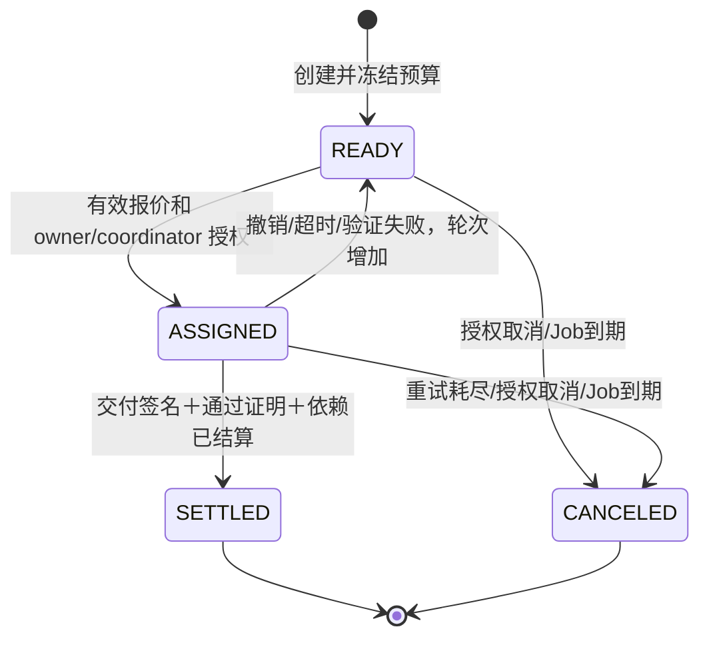

# DASC 依赖感知安全组合结算协议 v1

对应原方案第 2 章、5.3 节、S1～S6。实现：`contracts/src/TaskEscrow.sol`。

## 对象与编码

- Job ID：bytes32；业务字符串建议统一以 UTF-8 的 Keccak-256 映射，并在 A 的数据库保留对应关系。
- Task ID：uint8，单 Job 1～16 个任务，按照拓扑顺序一次性创建。
- 金额：固定测试 ERC-20 的最小单位 uint256，MockUSDC decimals=6。
- 需求与验证策略：创建时固定 requirementHash、validationPolicyId，不能在付款前改写。
- 执行轮次：uint32，初始为 0；撤销、超时、验证失败、取消均使旧轮次无法继续结算。
- 报价、交付与验证：分别由 Agent、Agent、授权验证者进行 EIP-712 签名。
- 域：name=DASC、version=1、运行时 chainId、当前 verifyingContract。

完整字段、顺序和类型以 `packages/schemas/eip712-types.json`、ABI、Python Schema 为准。

## 状态与正常流程



业务的 RUNNING、VERIFYING 等状态由 A 维护，合约只保存影响资金的状态。链上状态是资金事实来源。

1. owner `approve` 测试代币后调用 `createJob`，一次性冻结任务配置。
2. B 的报价绑定 Job/Task/attempt、执行者、价格、需求、代币、时效与 bidNonce。
3. owner 或该 Job 的 coordinator 调用 `assignTask`，固定 payee、报价和截止时间。
4. Agent 提交结果内容的 Keccak-256 和 artifact URI 的 Keccak-256，并签署 Result。
5. 验证者按固定政策复算，签署 Attestation。签名只证明批准，不能证明客观真实。
6. `settleTask` 同时验证两份签名，成功后记入 Agent 的 withdrawable。
7. Agent `withdraw`。所有任务 SETTLED/CANCELED 后任何人可 `finalizeJob`；退款只能由 owner 领取。

## 六组硬约束

| 约束 | 实现 |
|---|---|
| S1 身份 | 报价/结果恢复地址必须匹配绑定执行者；收款人是 payee，不是调用者 |
| S2 报价 | 域隔离＋完整消息字段；有效期检查；全合约按 Agent 钱包消费 bidNonce |
| S3 依赖 | depsMask 只指向更小编号；只有 `(settledMask & depsMask) == depsMask` 才能成功结算 |
| S4 轮次 | 当前 attempt 与交付/证明一致；撤销后重新报价；终态不能恢复 |
| S5 资金 | 配置预算之和≤deposit；acceptedPrice≤budgetCap；每任务一次结算；待提现与退款分账 |
| S6 凭证 | 验证者授权、策略、结果哈希、Job/Task/attempt、到期和 attestationNonce 全部核对 |

## 时限、取消与竞态

assignmentDeadline=min(委派区块时间＋executionWindow, Job固定deadline)。结算要求当前时间严格小于 assignmentDeadline；超时要求当前时间大于或等于该值，两者没有同时允许的边界。

Result.submittedAt 要求不早于 assignedAt、不晚于当前区块时间，并严格早于 assignmentDeadline。结果中的时间是签名元数据，并不证明现实中的实际提交时间；本实现要求结算交易也在截止时间前确认。

`expireTask` 任何人可在到期后触发。`revokeTask` 由 owner/coordinator 触发。有效的 false Attestation 产生 ValidationFailed 并作废当前轮次，报酬为零。达到 maxAttempts 后取消。

取消上游时按拓扑顺序传播到所有尚未结算的依赖任务。固定 Job 截止时间到达后任何人可 `expireJob`，包括尚未委派的任务，避免协调者离线导致永久锁款。所有终态之后仍需 `finalizeJob` 和 owner 领取退款。

## 会计模型

`totalAvailable`：所有活动 Job 的 remaining＋所有未领取退款。

`totalPending`：所有 Agent 的未领取报酬。

排除意外外部转入、手续费和重基准：

```text
合约余额 = totalAvailable + totalPending
totalDeposited = totalWithdrawn + totalRefunded + 合约余额
```

结算时 remaining/totalAvailable 减少、withdrawable/totalPending 增加。finalize 只是把 remaining 转为 refundable，不减少合约余额。提现与领取退款先清零内部额度再转账，使用 SafeERC20 与 ReentrancyGuard。

## 工程约定

本实现只有构造时指定的一个 ERC-20，不接收任意付款代币。创建 Job 时还检查实际到账差额，拒绝存款手续费行为。对重基准或恶意回调代币不提供业务兼容性承诺。

验证者及中继角色由平台管理员授权；每个 Job 独立 owner/coordinator。已签名凭证可由授权中继提交，但报酬只能归绑定 Agent。P1 双验证者、争议期和动态预算调整未实现。
