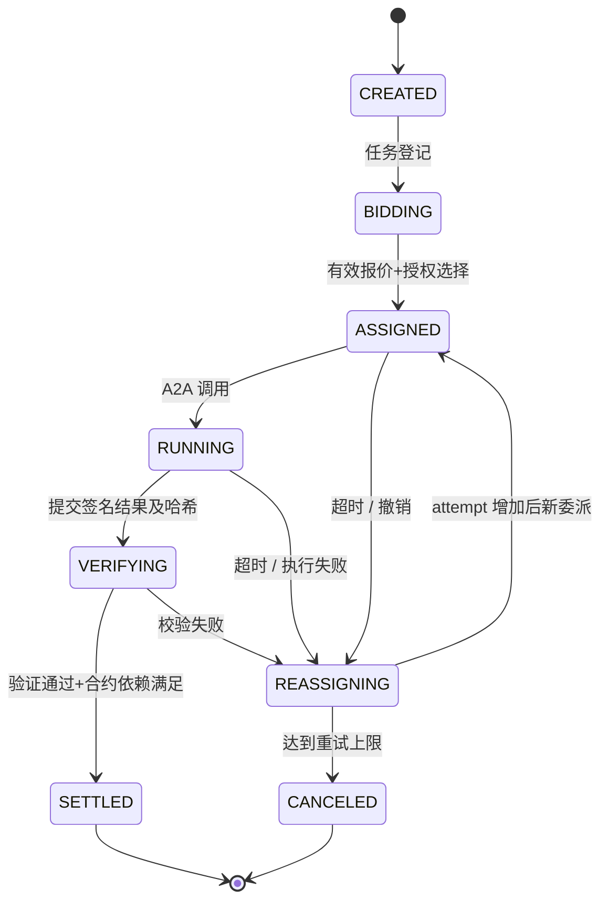
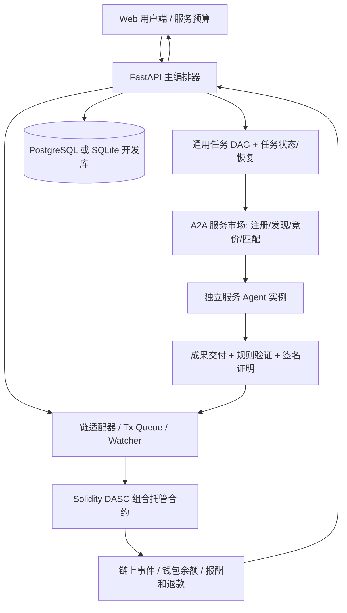
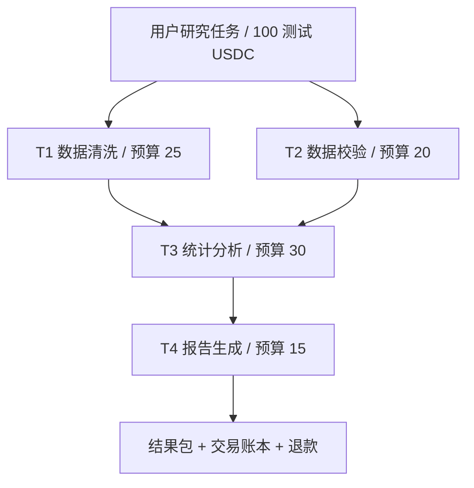

# 面向多智能体协作的自主任务交易与组合支付平台

## 10 天 × 4 人研发、最终交付分工与安全实验完整方案（安全结算创新强化版 v3.1）

> **定位**：CCF 区块链类竞赛候选作品的开发与提交执行方案。计划以“**不可信 Agent 协作中的依赖感知安全结算协议**”作为第一创新点，以“**自主发现、竞价、动态组合和局部恢复**”作为应用机制，并用**跨组织数据分析**和**旅游规划**两个场景验证通用性。
>
> **交付范围**：设计报告、测试报告、完整可执行源码、测试脚本、实验数据、部署和复现说明。不安排 PPT、答辩排练、宣传视频。
>
> **周期与资源假设**：4 人 × 10 天 × 每天约 7～8 小时；使用本地 EVM 测试链和测试 ERC-20，必要时可选公开测试网；有可用的 LLM 接口或固定数据兜底；不要求开发生产级去中心化仲裁系统。
>
> **诚实性原则**：以下所有性能数值是**验收目标或示例，不是已经测得的成果**。所有报告指标须从实际测试日志计算；不得将 Agent 自述、签名合法或验证者批准包装成“结果客观真实”。

---

## 0. 本轮修订解决什么问题

| 原方案风险 | 修订后的决定 | 最终证据 |
|---|---|---|
| 普通托管、退款和权限控制是既有智能合约能力 | 提出并实现 **DASC：Dependency-Aware Secure Composition Settlement，依赖感知安全组合结算协议**，明确签名报价、结果承诺、依赖约束、执行轮次、预算约束和付款状态机的组合规则 | 协议定义、合约代码、安全不变量、攻击用例 |
| 中心化 `VERIFIER_ROLE` 可以为无效成果放款 | 明确验证者信任边界：P0 实现可验证的客观规则、授权签名和链上凭证核对；P1 可加入第二独立验证者 / 复核，**不宣称已解决恶意授权验证者问题** | 正常验证、恶意授权验证者风险说明、独立可复算用例 |
| 旅游场景难体现区块链必要性 | **跨组织数据分析任务交易作为主场景**，旅游规划作为二次复用场景 | 同一合约、调度器和交易市场完成两个不同场景；跨主体履约风险实验 |
| 只有正常单测，缺少抗攻击论证 | 加入恶意 Agent、恶意报价者、重放攻击、旧轮次结算、越权、预算争抢、依赖绕过、故障与拒付等对抗实验 | 可运行攻击脚本、测试输入、日志、余额前后对照 |
| 10 天任务过多、容易只做包装 | 设置 P0/P1/P2 优先级；10 天内完成正常支付闭环、核心安全对抗与可执行交付 | Git tag、CI 记录、文档追踪矩阵 |

### 本作品的完整论证链


**报告中心论点**：区块链在这里的必要性不是“存一个任务状态”，而是为**互不完全信任的独立服务提供者与委托者**建立公开可核验、难以单方篡改的任务级资金约束和结算记录。合约解决资金托管与授权结算问题；**不**自动解决链下数据真假、分析质量或验证者串通问题。

### 三种重要边界

1. **协议创新 ≠ 重新发明密码学基础设施**：EIP-712、ERC-20、ECDSA、权限和重入防护都是成熟技术；创新重点是把它们与任务依赖、Agent 委派轮次、结果证明和预算结算联结成一组可验证的状态约束。
2. **智能合约安全 ≠ 业务结果一定正确**：签名证明谁同意了某个哈希；哈希证明提交前后内容相同；都不能单独证明报表数字真实。
3. **两个场景 ≠ 能执行任意开放任务**：底层任务/交易/结算引擎应当领域无关；实际可执行范围限于注册的技能及其对应验证规则。

---

# 一、总体目标与验收边界

## 1.1 最终交付清单

| 材料 | 必须性 | 主要内容 | 统稿/责任人 |
|---|---|---|---|
| **设计报告** | 必交 | 背景、风险与需求、威胁模型、创新协议、系统设计、软件流程、实现功能/指标、信任边界、核心实现 | **A 统稿**，B/C/D 分章节提供 |
| **测试报告** | 必交 | 测试平台、工具及版本、测试数据、功能/安全/对抗/性能实验、执行日志、结果分析、局限性 | **D 统稿**，C 负责安全实验数据，A/B 提供业务实验 |
| **可执行代码** | 必交 | 前后端、实际运行的 A2A Agent、合约、链适配器、环境锁文件、启动/重置/测试脚本、示例数据 | **D 发布统筹**，各模块负责人负责自己源码 |
| 其他文档 | 选交，强烈建议 | README、部署说明、API 与消息 Schema、协议规范、安全假设、实验复现手册、已知问题 | D 维护目录，各人维护对应内容 |

**最终验收方式**：在一台干净电脑克隆发布 Tag，按 README 完成依赖安装、合约部署、服务启动、两个场景运行和核心测试，且报告中的重要数据能溯源到相应脚本与原始日志。

## 1.2 10 天内必达与可延后能力

| 等级 | 功能 | 判定原则 |
|---|---|---|
| **P0** | 通用 DAG 拆解、依赖校验、至少 4 子任务、并行调度 | 同一任务描述模型适用于两个场景 |
| **P0** | A2A Agent Card、实际服务调用、动态注册/下线、竞价 | 非硬编码四次本地函数调用；可在运行时注册新实例 |
| **P0** | **DASC 安全协议第一版**：报价签名、结果哈希/签名绑定、权限、依赖、执行轮次、托管与支付 | 缺一项都不能宣称协议完成 |
| **P0** | 规则验证、签名证明、链上结算、任务失败不支付、余额退还 | 可完整追踪交易 ID 和相关证据 |
| **P0** | Agent 超时重新委派，旧轮次证明失效 | 至少一个可重复的真实恢复实验 |
| **P0** | 跨组织数据分析完整主场景 | 用固定合成数据可离线复现 |
| **P0** | 设计报告、测试报告、自动化安全与对抗实验、从零部署 | 报告不出现没有运行证据的“已实现” |
| **P1** | 旅游场景完整复用 | 不修改通用结算合约与通用调度核心 |
| **P1** | 信誉/风险感知选择与基线对比 | 有重复实验和原始数据 |
| **P1** | 双验证者签名/独立复核（仅适用于明确规则） | 作为缓解单点信任，不当作去中心化仲裁 |
| **P2** | 自动生成新 Agent 代码、任意开放市场、分布式争议仲裁、多链、ERC-8004/x402 集成 | 本期不承诺实现，属于后续研究 |

## 1.3 拟达到的可测指标（目标，不是实测）

| 指标 ID | 建议验收目标 | 证据生成方式 |
|---|---|---|
| G-01 | 主场景 4 个任务节点；至少 2 个可并行 | DAG JSON + 调度事件 |
| G-02 | 运行 6～8 个真实 A2A 服务实例，覆盖 ≥4 种技能 | 实际 Agent Card 与 A2A 调用日志 |
| G-03 | 至少一个技能有 2 个有效报价提供者 | 签名报价与排序记录 |
| G-04 | 单 Job 的结算总额永不超出已存入的托管额 | Foundry invariant + 余额记录 |
| G-05 | 所有 P0 授权/重放/旧轮次/依赖绕过负面测试都正确拒绝 | 攻击测试报告 |
| G-06 | 正常端到端实验执行至少 10 次，记录成功次数和耗时 | 固定数据脚本输出 JSON/CSV |
| G-07 | 预定义故障/恶意行为测试至少 20 类，分组记录每项结果 | 对抗实验用例矩阵 |
| G-08 | 超时恢复后只为最终有效执行者支付一次 | 主备 Agent 的付款事件 + 余额 |
| G-09 | 同一核心协议至少支持数据分析与旅游两场景 | 两套配置文件和实际运行日志 |
| G-10 | 他人按 README 能重建全部关键测试 | 新环境复现实录 |

**可行性约束**：如正常端到端链路尚未成功，优先修 P0，不继续做信誉算法或精致 UI；如核心安全规则尚未通过，则第二场景只保留验证模板，不将其包装成已完成的业务产品。

---

# 二、核心创新：DASC 依赖感知安全组合结算协议

## 2.1 为什么普通托管还不够

普通托管通常围绕“一个买家—一个卖家—一个结果”。这里存在复杂任务中独立服务商的**有依赖的多笔交易**：

- 一个任务被拆成 T1、T2、T3……，中间成果被下游任务消费；
- 每个任务的 Agent 不同，可能临时加入市场，可能故意伪造报价或延迟交付；
- 上游未履约时，下游不得提前结算；
- 同一任务可能多次委派，旧 Agent 不得持过期凭证重复领取报酬；
- 总资金有限，任一任务均不能抢占其他任务已承诺预算；
- 平台调度器可能出错或作恶，因此**禁止仅依赖它的数据库判断是否付款**。

DASC 不主张其中任一单独技术前所未有，而主张它们针对**多 Agent 依赖型交易**形成完整的协议组合，并通过形式化不变量和攻击实验验证。

## 2.2 威胁模型与必须诚实说明的信任假设

| 参与方 | 可能出现的恶意/故障行为 | 本期可提供的保证 |
|---|---|---|
| 服务 Agent | 篡改报价、冒充其他 Agent、发送错误结果、重放历史结果、超时后仍索款 | 报价/结果签名校验、身份钱包绑定、哈希和轮次绑定、超时失效、拒绝重复结算 |
| 协调者/主 Agent | 分配错误、重复委派、过度承诺预算、错误执行顺序 | 合约的预算、依赖、签名、任务状态等硬约束；但协调者可能拒绝服务或恶意选择授权范围内的服务 |
| 未授权第三方 | 伪造验证结果、调用付款、冒领报酬、篡改执行者 | 验证签名与授权检查、接收方绑定、合约状态检查 |
| 授权验证者 | 将质量不合格的成果错误判为合格，甚至恶意批准 | **P0 无法在链上自动辨别主观质量**；可独立复算的规则能降低风险，P1 的复核可减少单点决策风险 |
| 链下数据库/Watcher | 漏事件、重复发交易、重启后重发 | 链上幂等约束 + 事件重扫与状态对账，不能把数据库作为资金事实来源 |
| 区块链环境 | 交易未确认、链重组、RPC 中断 | 演示采用本地确定性链；记录确认策略，公开测试网使用额外确认等待 |

**本期默认假设**：示例 ERC-20 为无转账手续费、无重基准的测试代币；密码学私钥未泄露；授权验证者至少按预设客观规则诚实履行职责；本地链正确执行 EVM 逻辑。**不保证**授权验证者串通时仍能自动判断数据真伪、不保证跨组织原始私有数据无需信任即可共享。

## 2.3 统一对象与状态

```text
Job
  jobId, owner, paymentToken, deposit, remaining,
  taskCount, settledMask, terminalMask, jobState

Task[i]  (i = 0..15)
  requirementHash, depsMask, budgetCap, acceptedPrice,
  payeeWallet, attempt, deadline, state,
  quoteHash, resultHash, validationPolicyId

Quote（执行者签名）
  jobId, taskId, attempt, agentWallet, price,
  requirementHash, paymentToken, validUntil, bidNonce

Result（执行者签名）
  jobId, taskId, attempt, agentWallet,
  resultHash, artifactURIHash, submittedAt

Attestation（授权验证者签名）
  jobId, taskId, attempt, resultHash,
  validationPolicyId, verdict, validUntil, attestationNonce
```

说明：`jobId/taskId` 为业务与链上唯一可对应的 ID；任务依赖通过有限任务集合的位图表达，**P0 单 Job 最多 16 个任务**；链上只保存结果哈希或内容寻址指针的哈希，不上传业务原始数据。签名对象采用 EIP-712 类型化数据，域至少绑定 `chainId`、`verifyingContract`、协议名称和版本；消息字段必须完整绑定身份、价格、任务、轮次和时效。采用 OpenZeppelin 的 ECDSA/EIP712 辅助工具，避免自写签名恢复逻辑。

### 链上任务依赖的合法性

约定任务按照拓扑顺序登记。节点 `i` 的依赖 `depsMask` **只允许指向编号小于 i 的任务**：

```text
depsMask & ~((1 << i) - 1) == 0
```

这样 P0 在链上低成本拒绝自依赖和后向/成环依赖。只有依赖节点已经满足**链上已结算**条件，下游任务才具备结算资格：

```text
(settledMask & depsMask) == depsMask
```

可允许上游执行与下游准备过程在链下并行，但**不能**越过链上依赖要求进行最终结算。此设计必须在报告中说明所作的性能与严格性取舍。

## 2.4 状态机与协议流程



**状态分别在哪里维护**：业务调度状态在数据库；链上只维护**影响资金安全的状态与不可变凭证**。数据库被篡改不应使合约越权付款。取消依赖节点之后，尚未结算的后续依赖任务要进入取消/失败收尾流程，防止锁款永远无法退出。

协议最小正向路径：

1. 用户创建 Job，托管测试 ERC-20，确定任务预算上限、验证策略、任务依赖和每个 Job 的授权协调者；整体预算不可超托管。
2. Agent 通过 A2A 返回报价，由**出价 Agent 的结算钱包**对报价签名；服务市场记录签名数据，核验价格、到期时间和技能。
3. 被用户授权的协调者执行 `assignTask`，合约核对签名报价、受托执行者、轮次、报价金额与任务预算，将该轮次与 Agent 钱包锁定。协调者不是无限制提款人。
4. Agent 执行并对结果元数据签名；成果保存在链下且有内容哈希，任务证据关联同一 Job/Task/Attempt。
5. 验证器执行指定规则，生成绑定结果哈希、轮次和判定的证明；授权验证者对证明签名。
6. 合约通过 `settleTask` **分别验证 Agent 对交付结果的签名和验证者对结果判定的签名**，并核对报价/执行者、结果哈希、验证策略、依赖、时限、轮次、任务状态和余额，将报酬计入执行者的**待提现余额**。
7. Agent 主动 `withdraw`；全部任务终止后，用户领取未使用资金。采用拉取式付款，避免付款过程中执行外部回调影响核心状态转换。

> 注意：实际接受报价时，Agent 钱包与 A2A 端点必须有可审核绑定记录，不能仅凭某个 URL 中的“自我声明”认定钱包属于这个服务。P0 可通过注册者签名并由服务市场做端点挑战的方式建立绑定。签名证明密钥控制权，不证明业务声誉。

## 2.5 六组协议安全约束（以测试证明，而非口号）

| 约束编号 | 约束 | 合约或系统实现重点 |
|---|---|---|
| S1 身份约束 | 报价者、任务执行者、收款钱包和记录中的身份匹配 | EIP-712 签名、注册绑定、固定收款地址 |
| S2 报价约束 | 报价不得被改价、挪到其他 Job/Task 或其他链/合约、过期使用 | 字段完整绑定、域分离、报价 nonce、过期检查 |
| S3 依赖约束 | 未结算依赖任务前，子任务不得结算 | `settledMask` 与 `depsMask` 校验 |
| S4 轮次约束 | 被撤销、超时或替换的旧委派结果不能结算 | `attempt` 单调递增；每次验证证明绑定轮次 |
| S5 资金约束 | 实际结算额不得超报价、任务预算及总托管；不能重复支付或退款 | Job 账本、任务唯一结算、预算预留、pull payment |
| S6 凭证约束 | 只有符合授权的验证决定才可驱动结算；同一凭证不能跨任务重放 | 授权签名、结果哈希、任务 ID、轮次与 nonce 绑定 |

**必须满足的核心会计不变量**（同一种测试 ERC-20，排除外部无关转入）：

\[
\text{用户累计存入}=\text{已提现给执行者}+\text{已退还给用户}+\text{合约尚持有的余额}
\]

合约尚持有余额内包含未结算任务资金、未领取退款和 Agent 的待提现款。针对多 Job，要求全局账目合计一致；另需测试任何一次成功结算 `paid(taskId) ≤ acceptedPrice ≤ budgetCap`、且一个 Task 最多有一次有效结算。

## 2.6 异常处理和关键工程细节

- **超时触发**：合约不会主动在某秒执行。链下 Watcher 发现超时后调用任何人可触发的 `expireTask`（有链上时间约束），协调器在读取链上最新轮次后重新竞价/委派。
- **防止超时竞态**：以合约交易最终排序为准：旧轮次先结算则不允许过期重派；过期先完成状态转移，则旧凭证失效；无“两边均付款”。
- **任务预算预留**：创建/配置任务时保证各任务 `budgetCap` 之和不超过用户托管金额；重委派不新增同一任务的预算预留。如果要求预算重分配，需独立授权操作和强校验，P0 暂不做。
- **结算者身份**：可由协调器、授权者或允许的中继者提交已签名凭证，**资金最终只能进入已绑定的执行者待提现余额**。调用者不是收款人。
- **验证策略固定**：创建/登记任务时把 `validationPolicyId` 与 `requirementHash` 固定在受保护状态中，`Attestation` 只能针对该策略产生；验证者不得在支付前单方改成更宽松的策略。
- **验证失败**：产生失败事件，不释放报酬；可重委派或按失败规则取消。重复执行请求必须幂等，不能因链下任务重发导致再次结算。
- **任务终止**：`finalizeJob` 仅在所有节点均处于 `SETTLED/CANCELED` 等终态后允许；依赖被取消的后续任务不得被遗忘；剩余可用金额只退给 Job 的 owner。
- **签名有效期**：报价和验证证明分别设置到期时间；执行完成结果的提交时效应符合对应业务 SLA，不应凭同一旧证明跨多轮复用。
- **重入和代币边界**：`SafeERC20`、`ReentrancyGuard`、检查-生效-交互顺序；P0 仅允许指定的标准测试代币，不声称兼容手续费代币。

## 2.7 验证者信任模型：什么能证明，什么不能

| 证据/机制 | 能够证明 | 不能证明 |
|---|---|---|
| Agent 数字签名 | 指定私钥认可特定报价/结果元数据 | 服务能力一定真实、交付一定优秀 |
| 结果哈希 | 提交与验证时引用同一份数据 | 数据是真实的或分析结论正确 |
| Schema + 确定性规则 | 字段、格式、取值范围、可复算统计量满足预设规则 | 开放式报告的全部语义质量 |
| 授权验证者签名 | 被认可的验证者批准了对应结果 | 验证者没有失误或串通 |
| 链上结算记录 | 合约根据当时的有效状态与凭证执行了规则 | 链下服务在真实世界达到所有商业目标 |

**P0 实现边界**：客观可复算成果优先（数值表、字段完整性、固定算法输出）；不凭一轮 LLM 评价直接付款。验证规则由任务创建时固定的策略 ID/哈希引用，链下留存规则版本及可复算脚本。

**P1 可选增强**：对关键任务引入两个**彼此独立管理密钥**的验证者确认，或加入短暂的争议等待期与冻结款项。前者降低单点误判概率，但若两个验证者串通仍不能保证真实性；后者需要额外授权与争议机制，十天内不纳入必须完成范围。

> 报告应单独设置「安全保证与剩余风险」章节。不要写“完全去中心化、完全无需信任、绝对保证 AI 结果正确”。

---

# 三、系统架构、技术路线与跨场景设计

## 3.1 业务与链上职责分离



**链下**：LLM 规划、工具调用、能力发现、报价匹配、结果文件、验证计算、调度恢复。**链上**：任务资金、受托钱包与报价承诺、执行轮次、依赖/状态、可验证的支付条件、不可重复结算、提款和退款。

## 3.2 技术选型（尽量少引入新组件）

| 模块 | 技术 | 具体用途 |
|---|---|---|
| Web | React + TypeScript + Vite + Tailwind + React Flow | DAG、Agent 报价、合约资金、攻击测试结果展示 |
| API/调度 | Python + FastAPI + Pydantic；LangGraph 可选 | 通用状态机、Schema 校验、检查点、事件流 |
| Agent 网络 | 官方 A2A Python SDK | Agent Card、消息和 Task/Artifact，独立进程通信 |
| 数据存储 | 开发 SQLite；稳定集成建议 PostgreSQL | Job、Task、Agent、Quote、Proof、事务事件 |
| 链上 | Solidity + OpenZeppelin + Foundry + Anvil | ERC-20、EIP-712、权限、状态/资金安全、攻击测试 |
| 链交互 | Python web3.py；前端 viem 只读/可选钱包签名 | 合约部署、交易、事件监听、签名构造 |
| 质量测试 | pytest + Foundry invariant/fuzz + Playwright | 模块、协议、集成和浏览器测试 |
| 运行封装 | Docker Compose + Makefile | 一键运行、单入口测试、标准化复现 |

不要求同一 10 天内再接入大型外部交易市场、第三方真实金融资产、真正多链结算和任意生成代码部署。若 SDK 版本变化导致时间损耗，先锁定一个通过标准 A2A 互通测试的版本，并在 README 标明。

## 3.3 主场景：跨组织数据分析任务交易（必须完整）

用户指令示例：

> “对三家组织提供的合成销售数据进行字段校验、数据清洗、季度统计、图表汇总和研究报告生成。预算 100 测试 USDC。各服务商独立报价与履约，只有通过验证的结果才付款。”

任务 DAG：



保留 10 测试 USDC 未配置给特定任务（示例）。业务上“组织”指互不完全信任的独立服务提供者或委托方，不代表本期已经连接真实企业。**原始数据使用合成/公开许可数据，不上传真实机构敏感数据至链上或不可信 Agent。**

| 任务 | Agent 技能 | 可客观验证的交付物 | 风险与对抗点 |
|---|---|---|---|
| T1 清洗 | `data_cleaning` | 清洗后 CSV、字段/行数/缺失值统计 | 故意删除行、错误类型、故意延迟 |
| T2 校验 | `data_validation` | Schema 校验明细、异常字段清单 | 伪造通过结论、冒用验证身份 |
| T3 统计 | `statistical_analysis` | 机器可复算的均值/汇总/分组统计 JSON | 输入结果换包、重复提交旧统计 |
| T4 报告 | `report_generation` | 报告 Markdown + 引用统计结果的索引 | 缺失章节、引用数据不一致 |

**可复现实验数据**：固定种子生成 3 份合成 CSV（例如 1000 / 3000 / 5000 行，数字仅作为测试设计），插入可控重复值、空值、异常日期和跨表键问题；每份文件的 SHA-256、生成参数与规则版本写入 `experiments/fixtures/manifest.json`。由固定脚本提供可复算的预期统计值。

**为何链上有价值**：T1～T4 分属不同服务商，需要跨主体的预算授权、付款条件、履约证据与审计记录。现实是否选择链上方案仍取决于成本、治理和信任关系；报告应与中心化托管/手动结算方案比较，不能声称所有数据分析都必须使用区块链。

## 3.4 第二场景：旅游规划（P1，跨场景复用验证）

示例：景点检索、酒店信息汇总并行 → 路线规划 → 报告生成。重用任务 JSON、发现协议、竞价、链上 DASC 合约、失败恢复和前端流程；只换 `skills`、Agent 实现及 `validationPolicyId`。

**跨场景复用成功的严格标准**：不修改 `TaskEscrow` 的业务逻辑、不在主调度器写 `if scenario == "tourism"` 的硬分支；通过场景配置和技能注册即可执行。若不能完整跑通，报告标注为“已完成场景配置，未完成完整 E2E”，不得计入成功场景。

## 3.5 动态 Agent 注册、发现和服务市场

- 服务 Agent 独立启动，发布 Agent Card、能力标签、连接端点、支持的数据格式。
- 市场接收通过身份挑战的注册，维护心跳/过期与可用状态。动态新 Agent 加入后可参与下一轮 RFQ；下线则从候选列表移除。
- 至少对 `data_cleaning` 或 `statistical_analysis` 提供两家不同的服务实例，证明非固定绑定。
- Agent 自行产生并签名 RFQ 报价；平台归一化比较价格、历史成功率和能力匹配度。排序在链下进行，**合约只负责检查最后被接受的有效报价与资金条件**。
- B 可以用相同 SDK 模板启动多种 Agent 实例，但每个实例需有独立配置、可核验的服务端通信与可区分的签名身份。

## 3.6 统一 JSON/HTTP 合约和事件接口

基础任务模型示例：

```json
{
  "job_id": "JOB-001",
  "task_id": 2,
  "skill": "statistical_analysis",
  "dependencies": [0, 1],
  "budget_cap": "30.000000",
  "deadline_seconds": 120,
  "requirement_hash": "0x...",
  "validation_policy_id": "stat_v1",
  "attempt": 0,
  "status": "BIDDING"
}
```

所有金额在接口中用十进制字符串表达，合约中按 ERC-20 最小单位整数计价；禁止用 Python/JavaScript 浮点数计算链上金额。日志链路保留 `correlationId / jobId / taskId / attempt / quoteHash / resultHash / txHash`。

| API | 作用 | 主负责 |
|---|---|---|
| `POST /api/jobs` | 目标、预算、场景配置 → 创建 Job | A |
| `GET /api/jobs/{id}` | 总状态、预算与任务列表 | A |
| `GET /api/jobs/{id}/dag` | 图节点和执行状态 | A |
| `GET /api/jobs/{id}/events` | SSE 任务/资金事件 | A |
| `POST /api/agents/register` | 加入已核验 Agent 服务端点 | B |
| `GET /api/agents?skill=...` | 发现/过滤候选服务 | B |
| `GET /api/jobs/{id}/quotes` | 签名报价、选择理由、验证结果 | B |
| `GET /api/jobs/{id}/settlements` | 支付账本与交易哈希 | C 提供，A 汇总 |
| `POST /api/demo/faults` | **仅本地测试环境**的故障注入 | B/D；默认禁用 |

`POST /api/demo/faults` 必须以环境开关和访问控制限制，仅允许本地测试身份使用，绝不能作为生产环境可公开调用的业务 API。

---
# 四、四人重新分工与职责边界

## 4.1 分工原则

此版不能再简单地由“C 一个人写合约，其他人做普通业务”。安全结算协议横跨**Agent 报价端（B）—主调度器（A）—合约（C）—对抗测试与证据（D）**，每人都要承担协议链路的一部分，避免最终安全性只有合约单测，没有真实跨层数据证明。

| 成员 | 核心研发职责 | 协议责任 | 文档与实验责任 | 不负责的边界 |
|---|---|---|---|---|
| **A：总体架构与编排/设计报告负责人** | 通用 Job/Task Schema、LLM-DAG、编排调度、结果验证接口、Watcher 协调和恢复 | 任务状态与链上轮次保持一致；制定协议流程和需求追踪 | 设计报告统稿；跨场景调度和故障恢复实验 | 不替 C 写支付状态机 |
| **B：A2A 市场与恶意 Agent 仿真负责人** | Agent Card、动态注册/下线、RFQ 竞价、签名报价/结果、可配置业务 Agent、故障注入 | 执行者身份—钱包绑定；报价与结果签名构造；历史轮次冒用场景 | Agent 市场部分设计章节；恶意报价/重放实验样本和日志 | 不直接修改链上任务余额 |
| **C：DASC 协议与合约安全负责人** | Solidity、ERC-20 托管、EIP-712 验签、预算/依赖/轮次、支付和退款、Python 链适配器 | 定义可验收的安全不变量、协议最小函数、权限和证据格式 | 协议设计和信任假设章节；Foundry fuzz/invariant 与安全实验数据 | 不替验证器判断真实数据质量 |
| **D：Web/系统集成与测试报告负责人** | React、SSE 事件、集成测试、Docker/CI、一键启动、数据可视化 | 任务、报价、验证、资金事件的端到端关联；完整复现实验 | 测试报告统稿；对抗矩阵和证据归档、版本发布 | 不根据前端猜测交易是否成功 |

**协作的硬规则**：A 负责“任务是什么、何时可执行”；B 负责“谁提供服务、签了什么”；C 负责“哪些状态允许钱转移”；D 负责“系统能否真实运行、测试证据能否复现”。每个模块至少有一名非作者的审核者。

## 4.2 报告章节责任（十天内完成，无逐日提交要求）

| 必要内容 | 主笔 | 十天结束时必须提供的原始材料 |
|---|---|---|
| 应用背景、问题定义、总体架构、功能指标 | A | 需求表、系统图、软件流程图 |
| 核心协议和交易状态机、威胁模型 | C，A 审核 | 协议 Schema、状态转移表、合约函数说明 |
| Agent 市场、A2A 接口、身份绑定、报价签名 | B | Agent Card、报价示例、签名示例 |
| DAG 规划、动态协作和故障恢复 | A，B 协助 | DAG JSON、恢复时序和关键代码位置 |
| 测试环境、测试数据、用例矩阵 | D | 环境版本、fixtures、运行脚本 |
| 恶意行为安全测试与资金不变量 | C，B 注入攻击 | `forge test`、测试记录、余额前后账本 |
| 跨场景功能/性能实验与比较 | A/B，D 汇总 | CSV/JSON、脚本、计算公式、图表 |
| 测试结果分析、风险及限制 | D，C 核对 | 全部通过/失败记录、已知问题 |
| 部署手册、程序运行与提交清单 | D | 干净环境安装/复现记录 |

上述分工只规定**最终完成责任**，不规定某个成员必须在哪一天完成某个章节。设计报告由 A 统稿、测试报告由 D 统稿，其他成员对自己负责的技术结论、测试结果与引用的代码路径负责。

## 4.3 协作与交接规则（由团队自行安排，不设逐日任务表）

- **统一仓库**：使用 GitHub Monorepo；四人通过短生命周期功能分支、Pull Request 和 CI 合并成果，`main` 保持可运行。
- **接口契约先行**：A/B/C/D 协商统一 `jobId`、`taskId`、`attempt`、钱包地址、EIP-712 TypedData、结果哈希、验证凭证、ABI 与事件字段；变更须同步更新 Schema、代码、测试。
- **先局部实现再端到端集成**：每个负责人交付带基本测试、示例输入和启动说明的模块；其他负责人通过 API/A2A/ABI 接口集成，不直接修改对方模块内部状态。
- **共同测试与交叉审核**：B+C 共同核验报价及结果的跨语言签名；A+C 共同核验任务状态、执行轮次与合约状态；A+B 共同核验委派/恢复；D 组织端到端实验和证据归档。
- **文档与证据同步**：接口、威胁模型、功能与测试结论随相应 PR 更新，不在最后统一补写未经验证的数据。遇到依赖阻塞，通过 Issue 指定负责人和所需接口。
- **唯一硬性时间要求**：从正式开工起 **10 天内完成全部 P0 功能、最终代码、设计报告、测试报告及复现资料**。个人工作的先后顺序由团队协调，原方案中的整体阶段性检查仅供自查，不作为个人每天的提交要求。

---

# 五、四名成员最终负责事项与交付物（统一十天完成）

本章替代原版逐日工作安排。只规定**每个人最终必须完成什么、交什么、如何验收**；不再按 Day 1～Day 10 分配个人任务。为方便交接，下面的文件路径均对应第六章的仓库结构，实际可在接口一致的前提下做小幅调整。

## 5.1 A：总体架构、任务编排与设计报告负责人

### 需要完成的事项

1. **通用任务表示和规划**：制定 Job/Task/DAG 的 JSON Schema、依赖关系、子任务预算、截止时间、执行轮次和成果引用格式；支持来自自然语言或配置模板的任务规划，严格校验环依赖、缺失输入和超预算计划。
2. **任务调度与自主协作**：实现任务就绪检测、独立任务并行、结果向后继节点传递、状态持久化及任务全流程 API；通过 B 提供的 A2A 客户端动态发现并委派服务，而非将执行者硬编码在主流程里。
3. **异常监测与局部恢复**：实现任务超时 Watcher、故障分类、重新询价、重委派、旧轮次失效后的状态更新、重启恢复和后继任务阻塞/解除；与 C 的链上超时、轮次规则保持一致。
4. **成果验证流程编排**：根据任务绑定的验证策略调用独立规则验证器，记录结果哈希、验证者签名与审计事件；严格区分“签名合法”和“内容客观真实”，不由 LLM 直接决定付款。
5. **跨场景复用**：完整实现跨组织数据分析的四节点 DAG，保留旅游规划作为第二场景；两种场景使用同一套通用调度与结算接口。
6. **设计报告统稿**：写清应用背景、拟解决问题、威胁模型、系统架构、软件流程、功能和指标、DASC 机制、创新性与信任边界，并合并 B/C/D 提供的技术章节。

### 最终交付物

| 交付物 | 建议位置 | 验收证据 |
|---|---|---|
| DAG/Job/Task/事件 Schema 与校验器 | `packages/schemas/`、`services/orchestrator/planner/` | DAG 合法/非法、预算校验单元测试 |
| 编排调度与 API | `services/orchestrator/scheduler/`、`services/orchestrator/api/` | 四任务 DAG、并行与依赖执行事件 |
| 超时监测、重委派与恢复逻辑 | `services/orchestrator/recovery/` | 主 Agent 超时、候补替换、服务重启恢复日志 |
| 场景任务配置和独立验证规则接入 | `scenarios/`、`services/orchestrator/validator/` | 数据分析主场景完整运行记录；第二场景复用证据（P1） |
| 架构图、流程图、设计报告终稿 | `docs/设计报告.md` 及对应图表 | 报告章节、代码路径与测试编号追踪表 |
| 调度与恢复实验材料 | `experiments/` | 顺序/并行、失败/恢复的原始 CSV/JSON 与复现命令 |

**A 完成判定**：用户任务能被合法拆解并在至少四节点 DAG 上执行；实际 A2A 服务结果能按依赖流转；一个 Agent 超时后可局部重新委派而不丢失已完成成果；设计报告能逐项引用对应代码和实验。

## 5.2 B：A2A Agent 市场、报价签名与恶意 Agent 实验负责人

### 需要完成的事项

1. **真实 A2A 服务体系**：基于 A2A Python SDK 提供符合协议的 Agent Card、服务发现、任务请求、任务回执和结果交付；构造 6～8 个可运行服务实例、至少四类技能，支持新 Agent 动态注册和下线。
2. **自主交易市场**：实现 RFQ 询价、候选报价、报价有效期、技能过滤、预算约束、选择理由与必要的重新报价；同类任务至少支持两个独立候选服务竞争。
3. **密码学身份与内容绑定**：实现 Agent 钱包身份关联、EIP-712 报价签名和交付结果签名，将签名绑定到链 ID、合约、Job/Task、执行者、价格、时效及执行轮次；提供能被 C 合约正确验证的测试向量。
4. **业务服务 Agent**：完整交付主场景所需的数据清洗、数据校验、统计分析、报告生成服务；生成可复算的结构化成果。旅游场景以配置或新增 Agent 实例完成可复用性验证。
5. **恶意行为与对抗输入**：构造签名后改价、旧报价重放、身份冒用、旧轮次结果提交、超时、恶意或无效 JSON、不可访问 Agent 等可自动注入的攻击/故障样本。
6. **文档和交易实验**：交付 A2A 对接说明、报价与结果消息 Schema、Agent Card 示例、身份绑定流程、服务选择与信誉实验原始记录，供设计/测试报告使用。

### 最终交付物

| 交付物 | 建议位置 | 验收证据 |
|---|---|---|
| Agent 注册/发现与竞价服务 | `services/marketplace/` | 动态注册/下线、双候选询价与选择记录 |
| A2A 服务框架及业务 Agent | `services/agents/` | 实际 A2A 交互日志、Agent Card、结果 Artifact |
| 报价/结果 EIP-712 签名模块 | `services/marketplace/`、`packages/schemas/` | Python/Solidity 交叉验签测试向量 |
| 可控恶意 Agent/故障注入样本 | `services/agents/adversarial/`、`experiments/attacks/` | 篡改、重放、冒名、无效成果、超时复现实验 |
| Agent 市场与签名协议文档 | `docs/agent-protocol.md` 等 | 设计报告可引用的字段、时序图与运行实例 |
| 报价和信誉策略实验数据 | `experiments/raw/`、`experiments/results/` | 竞价日志、基线比较数据及计算脚本 |

**B 完成判定**：主 Agent 在运行时能发现不同 Agent、收到有效报价、选择并委派服务；合约可核验所产生的签名；故障/攻击实例可被测试脚本稳定触发，且无需把 Agent 调用替换为伪造的本地函数结果。

## 5.3 C：DASC 安全结算协议、智能合约与安全证明负责人

### 需要完成的事项

1. **DASC 协议规格**：明确定义不可信 Agent 下的身份、报价、执行轮次、结果承诺、验证授权、依赖条件、预算守恒、退款与最终状态；给出威胁模型、信任假设、状态机和安全约束。
2. **真实资金托管和结算**：实现 ERC-20 测试代币托管，任务预算登记、合法委派、任务依赖约束、签名报价验真、验证凭证检查、结果哈希/轮次匹配、条件结算、可提现余额与余额退款。
3. **防伪造和防重放**：确保 EIP-712 域隔离、授权主体与钱包绑定、Job/Task/attempt 的重放保护、报价过期检查；同一子任务一轮有效执行不出现重复结算。
4. **失败后资金安全**：实现到期处理、执行轮次作废、重新指派和余额回收；锁定资金、已确认应付资金与可退资金的会计状态分离；与 A 共同保证链下重试不等于链上重复付款。
5. **完整安全测试**：Foundry 单元测试、模糊测试、invariant，覆盖越权、报价篡改、跨域重放、未完成依赖、旧轮次领款、并发预算、重复提现与恶意执行者等主要风险。
6. **验证者风险边界**：至少实现客观可复算规则的凭证绑定与授权验签；清楚说明已授权恶意验证者仍可能批准错误业务结果，不将合约安全等同于数据真实性；可选实现独立复核或双验证者策略。
7. **协议相关报告材料**：提交合约 ABI、部署脚本、跨语言签名验证说明、威胁模型、安全不变量、攻击测试结果和关键交易/余额证据。

### 最终交付物

| 交付物 | 建议位置 | 验收证据 |
|---|---|---|
| DASC 协议规范与威胁模型 | `docs/dasc-protocol.md`、`docs/threat-model.md` | 状态机、约束表、付款条件与信任边界 |
| 核心合约与 Mock ERC-20 | `contracts/src/` | Foundry 编译、部署和真实测试链交易 |
| Python 链适配器、ABI、部署脚本 | `services/`、`contracts/script/` | A 的调度器触发托管/支付/退款的交易与回执 |
| 单元、模糊、不变量及攻击测试 | `contracts/test/` | 安全约束 S1～S6 对应的原始测试日志 |
| 资金守恒、结算唯一性、拒绝支付证据 | `experiments/raw/security/` | 余额前后表、revert 证据、交易哈希 |
| 核心协议和安全测试报告章节素材 | `docs/`、`experiments/results/` | 能被设计报告/测试报告追踪的实测数据 |

**C 完成判定**：存在真实合约状态和真实转账；所有 P0 资金安全约束经测试验证，非法签名、越权、依赖不满足、失效执行轮次和重复付款均按预期拒绝；资金守恒及信任边界可以由他人重复审查。

## 5.4 D：Web 控制台、系统集成、测试报告与最终发布负责人

### 需要完成的事项

1. **前端可视化**：实现任务提交、DAG、Agent 市场和报价详情、执行状态、故障与恢复过程、成果下载、真实链上付款/退款/提现记录等界面；数据必须来自后端或链上事件。
2. **工程集成**：维护 GitHub Monorepo、环境配置、Docker Compose、依赖锁文件、GitHub Actions、前后端/合约联调、一键初始化与重置脚本；保证新电脑可依 README 启动。
3. **端到端测试与质量门禁**：联通 A、B、C 的模块，执行 REST/A2A/ABI 集成测试、Playwright 浏览器流程、正常业务和自动恢复流程；维护缺陷列表及 PR 审核状态。
4. **对抗实验执行及证据保管**：联合 B 注入恶意 Agent、联合 C 运行链上安全脚本、联合 A 验证任务恢复；按固定输入与版本保存成功/失败记录、余额变化、交易回执、测试命令和日志。
5. **统计分析与测试报告统稿**：编写测试平台、测试数据、测试方法、结果分析、失败样本和局限性；整合 A/B/C 的统计与安全结果，确保表格和图表来源于真实可复算数据。
6. **最终交付打包**：维护 README、部署与操作说明、提交包结构、SHA-256 清单、Git release tag；确保设计报告、测试报告、可执行代码与复现实验使用同一版本。

### 最终交付物

| 交付物 | 建议位置 | 验收证据 |
|---|---|---|
| 完整前端控制台和交互逻辑 | `apps/web/` | 可查询真实 DAG、报价、交易与成果的浏览器记录 |
| CI、容器化和一键运行脚本 | `.github/`、`infra/`、`Makefile` | 新环境拉取仓库后成功安装、构建、启动 |
| 集成和 E2E 自动化脚本 | `tests/integration/`、`tests/e2e/` | 正常流程、故障恢复、链事件映射测试输出 |
| 统一对抗用例与实验原始结果 | `experiments/scripts/`、`experiments/raw/` | 测试用例矩阵、JSON/CSV、日志与复现命令 |
| 测试报告终稿和复现手册 | `docs/测试报告.md`、`docs/部署与使用说明.md` | 测试平台、测试数据、结果分析与失败记录完整 |
| 最终提交包与发布清单 | `submission/`、`README.md`、`SHA256SUMS.txt` | 提交文件完整且报告与 Commit SHA 一致 |

**D 完成判定**：使用干净环境可以成功启动并执行主场景；测试数据和报告可以重算；所有与资金有关的页面状态能追溯到合约交易及事件；最终交付包包含设计报告、测试报告、可执行代码和复现说明。

## 5.5 四人必须共同完成的交接与最终验收

| 跨人协作 | 主要交接对象 | 十天结束时应当共同证明 |
|---|---|---|
| **A ↔ B** | 任务技能 Schema、RFQ、A2A 请求与结果、候补服务 | 真实 Agent 动态发现、竞价、执行、局部重委派 |
| **B ↔ C** | Agent 钱包绑定、EIP-712 报价/结果、跨语言测试向量 | 签名字段被改、被冒用、跨任务重放时会被拒绝 |
| **A ↔ C** | 任务依赖/轮次、托管预算、验证凭证、合约事件 | 未完成依赖不能结算、失效轮次不能收款、账本不超额 |
| **A/B/C ↔ D** | API/ABI/事件/运行命令、测试脚本和证据 | 端到端系统能启动，正常和对抗流程可以复现 |
| **全体** | 设计报告、测试报告、代码 Tag、测试输入及日志 | “不可信 Agent 风险→协议→系统→攻击实验→数据证明”的完整论证链 |

**统一截止与完成标准**：四人自行组织工作与联调，不设个人逐日任务和逐日提交要求。**第十天结束前**，全部 P0 功能、两份报告、可执行代码、自动化测试及关键原始证据必须完成；P1/P2 按原方案的优先级决定是否交付。最终是否完成以第十二章检查表为准，不能用口头描述替代代码和测试结果。

---

# 六、GitHub 仓库、分支、接口冻结与多人协作

## 6.1 统一 Monorepo 目录

```text
agentflow-pay/
├── apps/
│   └── web/                              # D：控制台、DAG、报价和链上资金状态
├── services/
│   ├── orchestrator/                     # A：DAG/任务状态/协调/恢复
│   │   ├── planner/
│   │   ├── scheduler/
│   │   ├── recovery/
│   │   └── api/
│   ├── marketplace/                      # B：发现/注册/询价/选型
│   ├── agents/
│   │   ├── common/                       # B：标准 A2A Agent 模板与签名辅助
│   │   ├── data_cleaning/
│   │   ├── data_validation/
│   │   ├── statistical_analysis/
│   │   ├── report_generation/
│   │   ├── travel/                       # P1：旅游场景
│   │   └── adversarial/                  # B：受控恶意 Agent，不能用于生产
│   └── chain_adapter/                    # C：EVM/RPC/交易队列/链上事件索引
├── contracts/
│   ├── src/
│   │   ├── TaskEscrow.sol                # C：DASC 合约
│   │   └── MockUSDC.sol
│   ├── test/
│   │   ├── unit/
│   │   ├── security/
│   │   ├── invariant/
│   │   └── helpers/
│   ├── script/
│   └── foundry.toml
├── packages/
│   ├── schemas/                          # A 主责；Task、Quote、Result、Attestation
│   └── test_vectors/                     # B+C：EIP-712 跨语言签名向量
├── scenarios/
│   ├── cross_org_analysis.yaml           # P0 跨组织数据分析
│   └── travel_planning.yaml              # P1 旅游规划
├── validators/
│   ├── policies/                         # A：客观验证规则/版本号
│   └── tests/
├── tests/
│   ├── integration/                      # A+B+C 联合
│   └── e2e/                              # D：端到端自动化
├── experiments/
│   ├── fixtures/                         # 固定种子和合成数据
│   ├── attacks/                          # 攻击脚本、预期结果
│   ├── scripts/                          # 一键实验+统计
│   ├── raw/                              # 真实原始日志(脱敏)
│   ├── results/                          # 统计结果
│   └── README.md                         # 复现实验方法
├── infra/
│   ├── docker-compose.yml
│   └── docker/
├── scripts/
│   ├── setup.sh
│   ├── dev.sh
│   ├── test.sh
│   ├── run-main-scenario.sh
│   ├── run-attacks.sh
│   └── reset-local-chain.sh
├── docs/
│   ├── 设计报告.md                         # A 统稿
│   ├── 测试报告.md                         # D 统稿
│   ├── dasc-protocol.md                   # C 主笔
│   ├── threat-model.md                    # C + B
│   ├── security-assumptions.md            # C + A
│   ├── contract-interface.md              # C
│   ├── agent-protocol.md                  # B
│   ├── api.md                             # A
│   ├── deployment.md                      # D
│   └── known-limitations.md               # D + C
├── .github/
│   ├── workflows/ci.yml
│   ├── CODEOWNERS
│   ├── ISSUE_TEMPLATE/
│   └── pull_request_template.md
├── .env.example
├── .gitignore
├── Makefile
├── README.md
└── LICENSE
```

**文件来源要求**：源码、合约 ABI 与配置是可追踪版本；报告不覆盖原始实验日志。禁止提交真实钱包私钥、服务密钥、真实企业数据、含用户敏感信息的 Agent 输入；本地测试专用示例账户需醒目标明只能用于测试链。

## 6.2 建仓库的操作

由 D 建私有 GitHub 仓库 `agentflow-pay` 并邀请 A/B/C：

```bash
mkdir agentflow-pay && cd agentflow-pay
git init -b main
printf '# AgentFlow Pay\n' > README.md
git add README.md
git commit -m 'chore: initialize monorepo'

# 在 GitHub 网页创建一个空仓库后：
git remote add origin git@github.com:<团队账号>/agentflow-pay.git
git push -u origin main
```

`<团队账号>` 是占位符。设置 `main` 保护规则：禁止直接推送、至少 1 名其他成员审核、必要 CI 通过才合并。若当前 GitHub 仓库套餐/权限不支持全部保护特性，则按同等团队协作规则人工执行，并在 README 说明。

建立 GitHub Project 列：`Backlog → Ready → In Progress → PR Review → Done`。每个 Issue 包含：任务、负责人、联调对象、截止日、验收用例、文档影响与 PR 地址。

## 6.3 分支工作流与命名

| 类别 | 分支示例 | 负责 |
|---|---|---|
| Task | `feat/dag-scheduler` | A |
| Agent | `feat/a2a-signed-quote` | B |
| Contract | `feat/dasc-settlement` | C |
| Web | `feat/security-evidence-panel` | D |
| Security | `test/replay-attack` | C/B |
| Docs | `docs/design-threat-model` | A/C |
| Fix | `fix/reassign-race` | 具体模块负责人 |

```bash
# 每个小任务从最新 main 创建短生命周期分支
git switch main
git pull --ff-only origin main
git switch -c feat/a2a-signed-quote

# 先运行所影响模块的检查，最后运行全局必要检查
make check

git add .
git commit -m "feat(marketplace): sign and verify RFQ quote"
git push -u origin feat/a2a-signed-quote
# 在 GitHub 发起 PR，审核/CI 通过后合并
```

**约束**：PR 不跨越几个大型模块随意改动；不在 `main` 强推；所有合约接口变动同步提交 ABI/签名测试向量更新；模块完成后及时合入稳定状态；签名格式升级必须同步升级测试向量和协议版本。

## 6.4 跨人审核路径

| PR 作者 | 强制优先审核 | 必须核对的内容 |
|---|---|---|
| A | B；涉及链上则 C | DAG、任务状态、幂等性、是否按 ABI 构造调用 |
| B | A；签名变更加 C | A2A 标准、报价字段、身份绑定、结果签名 |
| C | A；资金流程加 D | 余额不变量、签名域/过期、角色权限、不可重复结算 |
| D | A；支付页加 C | 前端不伪造交易成功、事件重连、报告证据原始性 |

任何**资金转移、验证授权、报价签名**相关 PR，至少提供一个正例和一个反例用例。接口变更 PR 必须同时修改 `docs/api.md` / `contract-interface.md` / 测试向量，否则不得合并。

## 6.5 CI 具体要求

| CI job | 最小基础检查 | 完整集成检查 | 安全专项检查 |
|---|---|---|---|
| Python | Ruff + pytest 模块测试 | DAG/任务状态/签名 Schema | 崩溃重试、恶意 Agent、E2E |
| Web | ESLint + typecheck + build | 基础前端 E2E | 余额/交易重放及断线恢复 |
| Contracts | `forge build` + 基础 ERC-20 测试 | 托管/依赖/验证/退款 | 签名/权限/fuzz/invariant |
| Interface | JSON Schema 校验 | EIP-712 同步验证、ABI 差异检查 | 攻击向量集成测试 |

**不要使用空测试脚本伪装绿色 CI**。每个检测的命令和测试数量写入测试报告，并保存 CI 执行的 Commit SHA。

## 6.6 模块接口冻结节奏

- **基础接口准备**：统一 Job/Task、钱包身份、预算单位、错误码、链 ID 和标准事件。
- **协议接口准备**：统一 Quote/Result/Attestation 的 EIP-712 TypedData 和跨语言签名测试向量。
- **跨模块联调**：确保单任务创建→验签→支付 ABI 可用，多任务正常结算接口保持兼容；任何变化都更新对照矩阵。
- **交付封版前**：停止引入新的业务功能，重点完善测试复现、报告和已知问题说明。

---

# 七、对抗安全测试：核心作品证据

## 7.1 测试分层

1. **L1 合约单元测试**：确定性地覆盖函数授权、状态转移、签名核对和退款。
2. **L2 模糊/不变量测试**：随机任务顺序、金额、重试轮次、并发序列，持续校验资金与状态不变量。
3. **L3 链下协议攻击测试**：通过真实 A2A Agent 构造恶意报价、重放结果和身份欺骗，送入正常调用链。
4. **L4 端到端故障恢复测试**：从平台入口发起任务，注入故障，检查重新委派、最终收款和退款。
5. **L5 实验基线比较**：与简单单任务/整单托管方案比较跨任务约束能力，并量化引入复杂约束的 gas 与时延开销。

## 7.2 核心攻击与异常测试矩阵（30 项）

下表中的“预期”是**应该达到的防御目标**；实际结果必须在十天交付期限内通过脚本运行后填写为 PASS/FAIL/SKIP，并附失败原因。

| ID | 攻击/异常 | 注入方式 | 预期防御行为 | 主要负责 |
|---|---|---|---|---|
| SEC-01 | 报价金额篡改 | 在签名后把 20 改 30 | 签名核验失败 | B+C |
| SEC-02 | 报价执行者篡改 | 将签名者改为另一钱包 | 签名与钱包身份不符，拒绝 | B+C |
| SEC-03 | 报价任务 ID 替换 | 将 T1 的 Quote 用于 T2 | 验签或任务哈希检查拒绝 | C |
| SEC-04 | 报价 Job ID 替换 | 将 Job-A 复制到 Job-B | 拒绝跨 Job 重放 | C |
| SEC-05 | 报价跨合约重放 | 在不同合约地址使用 | EIP-712 域校验失败 | C |
| SEC-06 | 报价跨链重放 | 修改链 ID 重新使用签名 | 域校验失败 | C |
| SEC-07 | 过期报价使用 | 使 `validUntil` 小于当前链上时间 | 拒绝签收委托 | C |
| SEC-08 | 报价 nonce 重放 | 重用已消费报价 nonce | 根据 nonce/任务状态拒绝非法重用 | C |
| SEC-09 | Agent 冒用服务身份 | Agent Card 宣称他人钱包但无法签名 | 注册挑战/签名绑定失败 | B |
| SEC-10 | 虚假服务能力 | 注册不具备的技能但结果不合格 | 客观验证失败，不支付；无法仅靠注册防止虚假宣传 | B+A |
| SEC-11 | 结果内容改包 | 将提交的 CSV 替换但不换证据 | 结果哈希不匹配，拒绝 | A+C |
| SEC-12 | 伪造结果签名 | 用其他钱包冒签 | 拒绝非执行者的签名 | B+C |
| SEC-13 | 旧任务结果重放 | 旧任务的 `Result` 用于新任务 | ID/哈希绑定不符，拒绝 | C |
| SEC-14 | 旧轮次重放 | attempt=0 失效后仍请求支付 | 轮次不匹配，拒绝 | A+C |
| SEC-15 | 超时后的迟交 | 已成功执行 `expireTask` 后旧 Agent 提交 | 无法结算旧轮次 | A+C |
| SEC-16 | 临近超时竞态 | 让到期与结算在同一区块附近竞争 | 只能选择一个最终状态，不能双付 | C |
| SEC-17 | 未完成依赖提前结算 | T1 未结算，强行结算 T3 | 依赖位图检查拒绝 | C |
| SEC-18 | 非法 DAG | 自依赖或循环依赖 | 任务登记阶段拒绝 | A+C |
| SEC-19 | 伪造验证者 | 未获授权钱包签名 `Attestation` | 拒绝 | C |
| SEC-20 | 验证证明跨结果使用 | proof 中的 `resultHash` 与交付不一致 | 拒绝 | A+C |
| SEC-21 | 验证证明跨轮次使用 | 旧 attempt 的授权验证签名重放 | 拒绝 | C |
| SEC-22 | 验证凭证重复使用 | 对同任务重复执行 `settleTask` | 第二次无报酬，不得重复结算 | C |
| SEC-23 | 未授权结算/退款操作 | 随机外部账户调用受限函数 | 权限/状态检查拒绝 | C |
| SEC-24 | 未授权修改执行者 | 未获 Job 授权的协调者更换 Agent | 拒绝 | C |
| SEC-25 | 超预算报价 | 任务报价 > `budgetCap` | 无法分配/结算 | B+C |
| SEC-26 | 多任务争抢同一资金 | 多节点预算合计 > 总托管 | 登记阶段拒绝，无法超额承诺 | C |
| SEC-27 | 重复退款 | 用户连续两次领取同一余额 | 第二次无法重复提款 | C |
| SEC-28 | 重新入侵/回调 | 使用测试恶意 token 或收款合约触发重入尝试 | 可接受 token 白名单/重入防护阻止非法状态 | C |
| SEC-29 | 数据库重复发送链上结算 | 重启后重复提交同一凭证 | 链上仍最多一次合法结算 | A+C |
| SEC-30 | 授权验证者恶意批准坏结果 | 有权限的验证者故意签名错误判定 | **P0 不能保证阻止**；客观复核报警并在报告列为剩余风险 | A+C+D |

关于 SEC-28：P0 正常支付合约支持的正式代币只有测试标准 ERC-20，恶意代币用例可针对通用交互组件或测试环境验证防护，不等于声称生产版兼容任意恶意代币。关于 SEC-30：**不得把“系统对恶意授权验证者仍会付款”记为安全测试通过**；这是明确识别的信任弱点，用来定义后续多验证者/挑战期研究。

## 7.3 安全不变量清单（Foundry invariant/fuzz）

| INV | 必须一直为真的性质 | 随机动作建议 |
|---|---|---|
| INV-01 | 所有 Job 之和的内部账目与托管代币余额守恒 | 随机创建、存款、委派、结算、取消、退款、提现 |
| INV-02 | 任务不能被结算超过一次 | 随机重复 `settleTask` |
| INV-03 | 成功报酬不超过签收报价和任务预算上限 | 随机报价、签名/金额组合 |
| INV-04 | 所有生效承诺不超过 Job 资金预留额度 | 随机多 Task 登记和委派 |
| INV-05 | 旧执行轮次不能重新变成有效轮次 | 多次 `expire/reassign/settle` 顺序排列 |
| INV-06 | 没有满足依赖的节点不能变成 SETTLED | 随机依赖和结算次序 |
| INV-07 | 退款不能侵占已产生的待提现报酬 | 先结算后退款再提款的组合序列 |
| INV-08 | 无授权者无法变更结算关键状态 | 随机 caller 调用受限制函数 |

`forge test` 所使用的 fuzz runs/invariant runs、随机种子、编译器版本和完整失败信息写入报告。结果需要人工复核是否因为测试 `assume` 条件过窄造成“虚假通过”。

## 7.4 完整攻击用例记录模板

以下模板写入 `experiments/README.md` 并用于每个攻击 ID：

```yaml
case_id: SEC-14
title: 旧轮次结果重放
scenario: cross_org_analysis
commit_sha: "<运行时实际提交 SHA>"
chain_id: "<实际本地链 ID>"
contract_address: "<实际部署地址>"
seed: 20261010
initial_state: "task=ASSIGNED, attempt=0, escrow=..."
action: "使 attempt=0 失效并重新分配到 attempt=1，随后提交旧证明"
expected: "旧证明不得结算；旧执行者新增可提现余额=0"
observed: "<由脚本采集，不预先填写>"
status: "PASS|FAIL|SKIP"
transaction_hashes: []
raw_log: "experiments/raw/security/SEC-14.json"
```

**用例通过的条件**不能只看前端提示“失败”。至少验证：合约真实结果（revert 或状态拒绝）、任务当前 attempt、旧/新执行者待提现余额、Job 的可退余额和链上事件；区分交易在 mempool 被丢弃和交易上链拒绝两类情况。

## 7.5 三类重点“恶意 Agent 与防御”复现实验

### 实验 A：报价被篡改与跨场景重放

- 控制条件：合法报价签名、固定账户和资金、固定链 ID。
- 攻击步骤：更改报价金额、taskId、jobId、合约地址或使用过期报价。
- 检查：`assignTask` 必须失败，任务未绑定恶意报价，资金未转移。
- 价值：证明平台的“自主交易”不仅有价格算法，还有密码学可核验的服务承诺。

### 实验 B：旧 Agent 超时后的重复领款

- 先让 Agent-A 成交并执行；Watchdog 发起到期交易；Agent-B 重新报价并接替。
- Agent-A 尝试用旧已签名交付结果、旧验证签名或重复交易请求付款。
- 检查：旧 attempt 不生效；B 在合法交付时可以结算；两者合计不能超过该任务的有效报价与预算。
- 价值：直接体现“协作恢复”与“链上付款”之间的状态耦合。

### 实验 C：未满足任务依赖与并发预算抢占

- 令 T1 与 T2 并行、T3 依赖二者；T1 失败或未结算时，尝试让 T3 提前结算。
- 构造超出总托管金额的任务预留或者重复配置同一 Task。
- 检查：依赖或预算检查阻止相关交易；所有已完成任务报酬与剩余资金仍可被正确核算。
- 价值：证明本协议的核心超出“一对一资金托管”的条件安全机制。

---

# 八、实验设计、评价指标与比较基线

## 8.1 四组必要实验

| 实验组 | 对照策略（基线） | 本项目策略 | 可重复测量的数据 |
|---|---|---|---|
| EXP-1 安全约束 | **自行实现的最简任务托管基线**：只按单任务标志付款，未提供完整依赖/轮次/签名绑定 | DASC 完整校验 | 对各自明确支持的攻击路径的拒绝率、付错款次数、合约 Gas 与复杂度 |
| EXP-2 恢复行为 | Agent 失败就中断 Job，后续人工重新发起 | 仅受影响节点重新报价与委派 | 恢复成功率、恢复耗时、复用已完成节点数、资金损失 |
| EXP-3 任务调度 | 依次运行 T1→T2→T3→T4 | T1/T2 并行、T3/T4 依赖执行 | E2E 总时长、节点等待时间、链上交易开销 |
| EXP-4 Agent 选型 | 最低有效报价优先 | 成本+信誉/失败风险综合选择 | 实际支付、失败数、平均完成时间、重派次数 |

**避免基线误导**：EXP-1 的简单托管基线仅是项目自行构建的对照实现，不代表行业内所有标准托管合约都存在这些漏洞；报告中明确双方约束集合不同，比较的是“增加跨任务安全规则带来的防护能力与额外成本”，不是凭空证明所有传统方案不安全。若主系统尚未稳定，不必开发完整额外基线前端；可采用最小对照合约与 Foundry 测试。

## 8.2 统一指标定义

**任务完成率**：

\[
\text{任务完成率}=\frac{\text{完成全部必需节点的 Job 数}}{\text{实际启动的 Job 数}}
\]

**故障恢复成功率**：

\[
\text{恢复成功率}=\frac{\text{注入故障后通过自动重派继续完成的 Job 数}}{\text{预定故障注入 Job 总数}}
\]

**恶意支付阻断率（仅针对预定义的可防御攻击集合）**：

\[
\text{阻断率}=\frac{\text{被正确拒绝且未发生违规付款的攻击次数}}{\text{纳入可防御集合的有效攻击总次数}}
\]

同时报告：攻击到达验证逻辑的实际次数、测试被跳过的次数、无法阻断的授权验证者误判案例（SEC-30）、误拒率、每类交易 Gas、交易提交至确认时间、任务平均恢复时间和资金结算误差。**不要把 SEC-30 从安全限制里隐藏。**

对于“节约时间百分比”，从实际重复运行的均值或中位数计算；建议报告均值、标准差或四分位距、样本量 N，并在可能时使用固定种子/固定人工延时保持策略可比性。

## 8.3 建议实验数据配置

```text
合成数据规模：small=1,000 行，medium=3,000 行，large=5,000 行
业务任务数：4 个/Job
Agent 能力：4 种，6～8 个运行实例
合约 DAG 上限：16 个任务/Job
正常运行次数：≥10（目标）
故障运行次数：每种核心故障 ≥5（目标，按时间调整）
安全测试：30 个定义案例，其中 SEC-30 为记录信任边界的非可防御例
基础资金：100 个标准测试 USDC（示例）
控制项：数据随机种子、LLM 温度、固定网络/模拟延迟、合约版本
```

真实 API 服务不可用时，允许使用**明确标识的本地确定性 Agent 执行器**，但 A2A 通信和真实合约操作仍应保留；测试报告区分“确定性执行器试验”和“真实 LLM 服务试验”，不能把前者称为真实 AI 推理能力。

## 8.4 证据保留和原始结果结构

```text
experiments/
├── fixtures/
│   ├── manifest.json
│   ├── generate_data.py
│   └── cross_org/...
├── attacks/
│   ├── SEC-01.py
│   └── ...
├── scripts/
│   ├── run_all.py
│   ├── run_security.py
│   ├── compare_baselines.py
│   └── summarize_results.py
├── raw/
│   ├── runs/                          # 每次正常/故障执行一个 JSON
│   ├── security/                      # 每个 SEC ID 一个结构化 JSON
│   ├── forge/                         # Foundry 原始输出
│   └── chain/                         # 部署地址、交易与事件导出
├── results/
│   ├── summary.csv
│   ├── settlement_gas.csv
│   ├── recovery.csv
│   └── figures/                        # 真实脚本生成的统计图
└── README.md
```

建议所有 JSON 记录共同包含：`case_id`、`run_id`、`timestamp`、`commit_sha`、`seed`、`environment`、`inputs_hash`、`job_id`、`task_id`、`attempt`、`tx_hashes`、`observed`、`status`。脱敏时保留公开测试钱包和交易哈希；不要公开私钥或外部服务凭证。

---
# 九、设计报告结构与可追溯写作要求

> 建议直接将以下框架作为 `docs/设计报告.md`。每个章节标注作者、代码路径、关联测试编号与图表来源；随开发进度持续填写，不在最后集中拼凑。

| 章节 | 必须回答的问题 | 必须给出的图/表/证据 | 主笔 |
|---|---|---|---|
| 第 1 章 应用背景与意义 | 独立 Agent 跨主体交易面临什么资金和协作风险？现有托管为何不够覆盖完整任务图？ | 风险案例、场景描述、适用边界 | A |
| 第 2 章 拟解决问题与需求 | 虚假委派、报价篡改、轮次重放、依赖越权、超预算和验证信任分别是什么？ | 威胁模型、功能/安全需求表、优先级 | A+C |
| 第 3 章 设计目标与创新 | DASC 为什么不是简单增加多个 Task？新组合约束是什么？ | S1～S6 约束定义、主要创新对比、关键不变量 | C+A |
| 第 4 章 总体技术架构 | 哪些链下、哪些链上？Agent、验证者、调度者边界为何这样分？ | 架构图、部署图、参与方及信任关系图 | A |
| 第 5 章 核心协议详细设计 | 报价、结果、证明分别签了什么？状态转移、权限、链上字段和定价怎样实现？ | EIP-712 数据结构、合约函数表、业务/链上状态机 | C，B 审核 |
| 第 6 章 多 Agent 自主协作 | 如何生成 DAG、发现 Agent、比较报价、并行、失败重新委派？ | DAG 图、A2A 时序图、服务注册示例、算法伪代码 | A+B |
| 第 7 章 成果验证与信任模型 | 哪些成果可复核？谁有权批准？恶意授权验证者风险如何说明？ | 验证策略表、可复算样例、信任边界和残余风险 | A+C |
| 第 8 章 两个业务场景实现 | 跨组织数据分析完整怎样运行？旅游场景复用了什么？ | 数据集与 DAG、Agent/技能映射、两个场景配置差异 | A+B |
| 第 9 章 实现功能与指标 | 功能是否完成，运行环境是什么，指标如何定义？ | 功能实现追踪表、源码路径、测试链接 | A，D 协助 |
| 第 10 章 软件流程与异常处理 | 从输入到结算、提现、退款如何推进？超时和故障的流程是什么？ | 正常流、异常恢复流、链上事件与状态迁移图 | A+C |
| 第 11 章 可靠性与安全分析 | 哪些性质由合约保障？哪些只能依赖验证者？ | 资金不变量、攻击面、已知限制、成本与取舍 | C |
| 第 12 章 总结与后续方向 | 已达成什么，未达成什么？下一步如何扩展到多验证者/争议处理？ | 已完成/未完成能力表 | A |

## 9.1 建议必须绘制的 7 张图

1. 总体系统架构与信任边界图。
2. 跨组织数据分析任务 DAG 与预算图。
3. Agent Card 发现、RFQ 报价、签名报价和委派时序图。
4. DASC 正常状态机及账本流转图。
5. 旧轮次失败、重新委派、旧证明被拒绝的安全时序图。
6. 数据/结果/验证凭证与链上哈希绑定关系图。
7. 对抗实验和结果统计方法图（避免画“想象中的”性能提升）。

可直接用 Mermaid 源码绘制并纳入报告，保证图可由仓库复现。若最终提交格式要求 Word/PDF，截止前再从 Markdown 导出，不改变原始报告的数据来源。

## 9.2 设计报告必有的“需求—实现—测试”追踪表

| Req ID | 设计要求 | 代码模块 | 测试编号 | 完成状态 |
|---|---|---|---|---|
| R-01 | 任务 DAG 无环、预算合法 | `services/orchestrator/planner/` | UNIT-DAG-01/02 | 待测试 |
| R-02 | A2A 动态注册/服务发现 | `services/marketplace/` | INT-A2A-01/02 | 待测试 |
| R-03 | 报价身份及金额不可篡改 | `contracts/` + `services/agents/common/` | SEC-01～SEC-09 | 待测试 |
| R-04 | 结果哈希与轮次绑定 | `validators/` + `contracts/` | SEC-11～SEC-15、20/21 | 待测试 |
| R-05 | 依赖完成后才结算 | `contracts/` | SEC-17/18、INV-06 | 待测试 |
| R-06 | 自动重派后旧轮次不能收款 | `recovery/` + `contracts/` | SEC-14～16、INV-05 | 待测试 |
| R-07 | 总托管资金及报酬安全 | `contracts/` | SEC-22～29、INV-01～04/07 | 待测试 |
| R-08 | 跨组织场景可执行 | `scenarios/`、`services/agents/` | E2E-DATA-01 | 待测试 |
| R-09 | 旅游场景复用（P1） | `scenarios/` | E2E-TRAVEL-01 | 待测试 |
| R-10 | 验证者信任边界透明 | `docs/security-assumptions.md` | SEC-19～21、SEC-30 | 待测试 |

状态必须在十天交付结束前根据实际代码与测试更新。对于“未实现”，写明替代方法和原因，不留空。

---

# 十、测试报告结构、测试平台与结果分析模板

> 建议直接将以下框架作为 `docs/测试报告.md`。所有表格的 PASS/FAIL、数值、截图和哈希在实际测试时填写，**现在不预填结果**。

## 10.1 推荐章节目录

1. 测试目的、范围、版本与通过准则。
2. 测试平台：软硬件规格、OS、CPU/RAM、Python/Node/Solidity/Foundry、Anvil 链 ID、合约地址、依赖版本。
3. 测试数据：数据来源、生成脚本、固定种子、数据规模、哈希、异常注入方法。
4. 测试方法：单元、接口、集成、端到端、合约安全、fuzz/invariant、对抗实验和性能基线。
5. 功能测试结果：DAG、A2A、竞价、结算、自动退款、跨场景能力。
6. 安全与恶意 Agent 实验结果：SEC-01～SEC-30、INV-01～INV-08；说明 SEC-30 不能被 P0 完整阻断。
7. 可靠性与恢复实验：超时、错误结果、崩溃重启、Watcher 重扫、并发预算争抢。
8. 性能和成本分析：端到端时间、恢复时间、Gas、实验重复次数、比较策略与统计方法。
9. 缺陷与问题处理：发现日期、原因、修复 PR、回归测试；未修复项与风险。
10. 最终结论：达到哪些指标、哪些未达到、外推限制和后续建议。

## 10.2 测试平台填写模板

| 字段 | 实际环境（运行后填写） | 记录要求 |
|---|---|---|
| 测试机器 | `待填写` | CPU/内存/OS/容器化情况 |
| Python/Node 版本 | `待填写` | `python --version`、`node --version` |
| Solidity/Foundry | `待填写` | `forge --version`、`solc` 版本与优化设置 |
| 合约链环境 | `待填写` | Anvil/测试网、chainId、起始区块 |
| 合约地址/ABI Hash | `待填写` | 编译产物一致性与部署记录 |
| LLM/Agent SDK | `待填写` | 模型服务/SDK 版本，是否确定性模拟 |
| 数据集及种子 | `待填写` | `manifest.json` 的 SHA-256 |
| 项目版本 | `待填写` | Git commit SHA/Tag |
| 测试命令与环境变量 | `待填写` | 移除敏感信息、提供 `.env.example` |

## 10.3 测试结果统一表

| Case ID | 类别 | 预期 | 实际结果 | 结论 | 原始证据 |
|---|---|---|---|---|---|
| SEC-14 | 旧轮次重放 | 不能再次收款 | 待执行 | 待执行 | `experiments/raw/security/SEC-14.json` |
| SEC-17 | 依赖绕过 | 未完成依赖不可结算 | 待执行 | 待执行 | `experiments/raw/security/SEC-17.json` |
| SEC-26 | 超额预算 | 多任务预算不可超过资金 | 待执行 | 待执行 | `experiments/raw/security/SEC-26.json` |
| SEC-30 | 恶意授权验证者 | P0 只能识别信任缺口 | 待执行 | 限制项 | `experiments/raw/security/SEC-30.json` |

**结果字段标准**：`PASS` = 达到预期且证据齐全；`FAIL` = 未达预期；`SKIP` = 有明确阻塞且记录原因；`LIMITATION` = 超出当前安全保障范围。不得把 `SKIP` 当 `PASS`，也不得把“系统允许授权验证者错误判定”隐瞒为防御成功。

## 10.4 结果分析应回答的关键问题

- 为什么签名报价与完整上下文绑定能防止改价/跨任务重放？是否有未经绑定的字段？
- 故障重委派时是否出现重复付款、双提交、旧轮次后补付款或误退款？
- 哪些约束由合约直接保证，哪些只由链下验证/服务市场保证？
- 规则验证能否复算，是否出现误判、误拒和验证者本身的单点问题？
- DASC 相比最简基线增加了多少 Gas/延迟/开发复杂度？代价是否值得？
- 旅游场景是否真的没有修改协议内核？如果修改了，改动属于可配置扩展还是业务硬编码？
- 样本量是否足以得出统计结论？失败日志是否被保留？

## 10.5 测试报告建议的核心图表

| 图表 | X/Y 或内容 | 产生脚本 |
|---|---|---|
| 图 T1 | 各攻击类别的测试数量与可防御结果 | `summarize_results.py` |
| 图 T2 | 旧轮次重放前后资金变化对照 | `run_security.py` 导出的账本 |
| 图 T3 | 传统/简化基线与 DASC 的 Gas 对比 | `forge snapshot` + 汇总脚本 |
| 图 T4 | Agent 正常/超时恢复的端到端时间分布 | `compare_baselines.py` |
| 图 T5 | 顺序调度 vs DAG 调度完成时间 | `compare_baselines.py` |
| 图 T6 | 最低价 vs 风险感知策略：成本与失败率 | `compare_baselines.py` |

图表是**运行后要生成的交付要求**，不是可直接写入报告的预置结论。

---

# 十一、可执行代码、部署与复现要求

## 11.1 推荐统一入口

D 在最终交付前确保以下 `Makefile` 目标可运行（命令含义为**设计目标**，需在实际工程实现）：

```bash
make setup             # 安装依赖、创建本地开发配置
make chain-up          # 启动本地 EVM 测试链
make deploy            # 部署 MockUSDC 和 DASC 合约并写入本地地址文件
make dev               # 启动后端、Agent 服务市场、服务实例和 Web
make check             # 运行 lint、类型检查及必要单测
make test-contract     # Foundry 合约测试
make test-integration  # A2A+编排+结算集成测试
make test-security     # 安全与恶意 Agent 实验
make run-data          # 主场景：跨组织数据分析
make run-travel        # P1：旅游场景
make collect-results   # 汇总 raw 结果为 CSV/图表
make reset-demo        # 重建本地测试状态；禁止真实链调用
```

**README 从零复现顺序**：

1. 检查操作系统、Docker、Python、Node、Foundry 的兼容版本，安装锁定依赖。
2. 复制 `.env.example` 到本地 `.env`；如没有外部模型权限，打开带明显标识的确定性本地模式。
3. 启动本地 EVM、部署合约并获取地址与 ABI；初始化数据库和合成数据。
4. 启动 A2A 服务 Agent、市场、主编排服务、Watcher 与 Web。
5. 运行 `make run-data`，查看 DAG、报价、验证、支付、退款和生成报告。
6. 运行 `make test-security`，确认攻击结果与链上资金审计一致。
7. 如 P1 可用，运行 `make run-travel`，证明核心系统不依赖分析领域。
8. 执行 `make collect-results` 并检查两个报告对应的实验数据。

## 11.2 必须固定的依赖与证据版本

- Python `requirements.lock` 或 `uv.lock`；前端 `package-lock.json`/`pnpm-lock.yaml`；Foundry 工具链、Solidity 版本和部署脚本。
- A2A SDK 和 OpenZeppelin 版本固定；EIP-712 类型名、域、字段顺序与测试向量固定。
- 数据合成脚本、随机种子、`manifest.json` 中的输出 SHA-256 固定。
- 每次实验记录 Git Commit SHA、链 ID、合约地址、合约字节码或部署版本哈希。
- 报告出现的代码片段和函数名应与提交 Tag 的版本一致。

## 11.3 交付目录（建议压缩前保持此结构）

```text
submission/
├── src/                         # 完整源代码仓库（含提交点或版本元数据）
├── reports/
│   ├── 设计报告.md
│   └── 测试报告.md
├── docs/
│   ├── 部署与使用说明.md
│   ├── 核心协议与信任边界.md
│   ├── API与签名格式.md
│   └── 已知限制.md
├── experiments/
│   ├── fixtures/
│   ├── scripts/
│   ├── raw/
│   └── results/
├── README.md
└── SHA256SUMS.txt
```

如比赛要求 PDF/Word 而非 MD，可根据官方模板转出报告文件；仍保留源 Markdown 和命令/实验原始结果。**提交前务必检查赛事具体命名、大小、压缩包以及匿名要求**，本方案不替代最新官方赛规。

---

# 十二、里程碑、风险、取舍与最终交付标准

## 12.1 十天统一交付目标（不设置个人逐日节点）

| 截止要求 | 必须具备的最终成果 | 未达成时的应对 |
|---|---|---|
| **十天内完成** | 通用四任务 DAG、真实 A2A Agent 竞价与协作、DASC 有效签名和真实链上托管结算、任务级条件付款及退款、失效轮次拒绝与自动恢复 | 优先修复 P0 核心闭环，暂停 P1 功能 |
| **十天内完成** | 报价篡改、重放、冒名、旧轮次、依赖绕过、预算超额等核心对抗实验及不变量验证 | 优先修复资金与授权安全缺陷，不以 UI 演示代替安全证据 |
| **十天内完成** | 完整设计报告、测试报告、可执行代码、部署说明、原始测试数据、复现脚本和版本 Tag | 对未通过项目如实标明状态、原因和影响，不虚报结果 |

团队可自行决定开发次序和内部检查时间；此表不对任何成员规定“第几天必须做什么”。

## 12.2 风险与收缩规则

| 风险 | 早期信号 | 具体预案 |
|---|---|---|
| EIP-712 跨语言签名不一致 | 跨语言报价向量在 Solidity 无法验签 | B+C 专项联调 TypedData；暂缓报价评分界面 |
| 合约开发量超过 10 天 | 单任务安全结算迟迟不能成功 | 保留签名/依赖/轮次/预算核心，取消复杂多轮协商和可选双验证者 |
| Agent SDK 互通不稳定 | A2A 调用始终只能模拟本地函数 | 先锁定一个可运行版本，实现少量真实服务，再扩展实例数量 |
| LLM 输出不稳定 | 多次生成非法 DAG | Schema 检查、有限重试和固定模板兜底；分别记录真实 LLM 与兜底测试 |
| 主场景数据质量难验证 | 报表由主观打分决定能否付款 | 先要求 CSV/JSON 统计结果可复算，报告的主观质量只作为辅助评价 |
| 链上/链下状态不一致 | 同一任务重复发结算交易 | 以合约链上状态为资金事实来源；RPC 交易回执确认和事件重扫 |
| 恶意验证者风险引发质疑 | 将 `VERIFIER_ROLE` 视为绝对可信 | 公开信任假设，提供复算脚本与独立复核思路，绝不夸大 |
| 多场景开发挤占安全时间 | 核心付款安全测试仍未完成 | 放弃 P1 旅游完整 E2E，优先完成主场景的完整安全论证 |
| 测试缺少真实证据 | 安全章节只有测试用例名没有日志 | 及时停止扩展功能，优先产出 raw 数据和明确 PASS/FAIL |
| 文档晚于代码两三天 | 设计/测试报告一直没有随开发同步更新 | 每个 PR 强制标注文档影响；报告随工程推进同步写 |

## 12.3 最终检查表

### A. 技术与核心创新

- [ ] 任务描述、资金与验证策略的 Schema 已冻结并有版本。
- [ ] 报价由 Agent 钱包进行 EIP-712 签名，跨 Job/Task/Chain/Contract 改动不可重放。
- [ ] 结果证明绑定 Agent、结果哈希、Job/Task 和执行轮次。
- [ ] 付款所需验证证明经过授权验证者校验，并与任务要求/结果绑定。
- [ ] 合约拒绝依赖不满足、超预算、未授权、旧轮次和重复结算。
- [ ] 超时后可重新发现 Agent、重新报价和重新委派。
- [ ] 旧 Agent 不能因旧证据额外获得报酬，用户剩余资金可退款。
- [ ] 合约状态、钱包余额、服务报价与报告数据可关联追溯。
- [ ] 成果验证的主观性及授权验证者单点风险被准确说明。

### B. 业务系统与可运行性

- [ ] 跨组织数据分析 4 个节点完整运行。
- [ ] 至少一类服务具备真实多 Agent 竞争。
- [ ] Agent 支持运行时注册/下线，非写死进主调度器。
- [ ] 旅游场景完成跨领域复用 E2E，或被如实标记为 P1 未完成。
- [ ] 仓库新环境可部署、启动、执行测试，并保存所用 Commit SHA。
- [ ] 没有任何真实密钥或机构隐私数据进入仓库。

### C. 报告、对抗实验与提交

- [ ] 设计报告覆盖应用背景、拟解决问题、设计方案、软件流程、功能和指标。
- [ ] 设计报告含协议、威胁模型、信任边界和安全不变量。
- [ ] 测试报告覆盖测试平台、数据、方法、结果与分析。
- [ ] SEC-01～SEC-30 均有执行状态、预期行为和对应原始证据/跳过理由。
- [ ] INV-01～INV-08 有可运行测试，未通过项记录问题。
- [ ] 恶意授权验证者无法彻底阻断的场景在局限性中被明确解释。
- [ ] 实验数据由脚本生成，不含虚构的成功率、性能提升或 Gas 数字。
- [ ] 源码、依赖、配置、报告、脚本和数据均位于最终提交包。
- [ ] 已固定版本 Tag、提交 SHA、合约地址和数据集哈希。

## 12.4 推荐作品标题与创新点表述

**作品标题（建议）**：

> **AgentFlow Pay：面向不可信多智能体协作的依赖感知安全结算与自主任务交易平台**

**第一创新点（核心）**：

> 设计 DASC 依赖感知安全组合结算协议，将服务 Agent 的签名报价、成果哈希承诺、执行轮次、任务依赖与预算约束统一纳入链上结算条件；结合真实恶意 Agent 对抗测试和资金不变量测试，验证跨主体协作环境中可被形式化表达的付款安全性质。

**第二创新点（协作与交易）**：

> 建立基于 A2A 的开放服务发现、动态报价和多 Agent 任务组合机制，结合任务图和信誉/风险约束，实现不同服务 Agent 的自主协作与竞争性履约。

**第三创新点（可靠性与通用性）**：

> 将故障检测、任务局部重新委派与链上旧执行轮次失效联动，构成可恢复的组合交易流程，并以跨组织数据分析和旅游规划验证业务无关的协议复用能力。

以上应使用“设计并实现”“通过测试验证”等**仅在代码与测试实际完成后才成立的表述**。若相关测试未通过，最终材料应明确调整为“设计目标、阶段性实现、尚待解决”。

---

# 十三、实施顺序的最后提醒

1. **先验证安全协议，再完善市场算法**：应优先让签名报价、支付状态和结果绑定成为真实可运行的最小链路。
2. **先做客观可复算的业务交付，再引入开放式 LLM 质量判断**：跨组织数据分析固定数据特别适合这个目的。
3. **先通过攻击和资金不变量，再做第二场景/界面优化**：安全论文式的“问题→机制→实验→证据”是作品主线。
4. **用真实实验结果界定可保护范围**：签名、合约与哈希解决可验证的身份/承诺/规则；对授权验证者的质量误判必须保留清醒的限制描述。

> **一页总结**：4 人 10 天的最终作品应当是一个**实际可运行的多 Agent 任务交易平台**，但最有竞争力的提交内容不是页面，而是**DASC 协议的具体安全约束、能反复重现的恶意 Agent 攻击实验，以及可解释的资金守恒和恢复结果**。设计报告回答为何及如何成立，测试报告给出哪些条件下成立，可执行代码证明它不是纸面设计。
