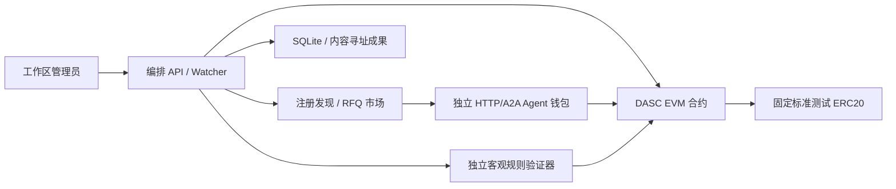
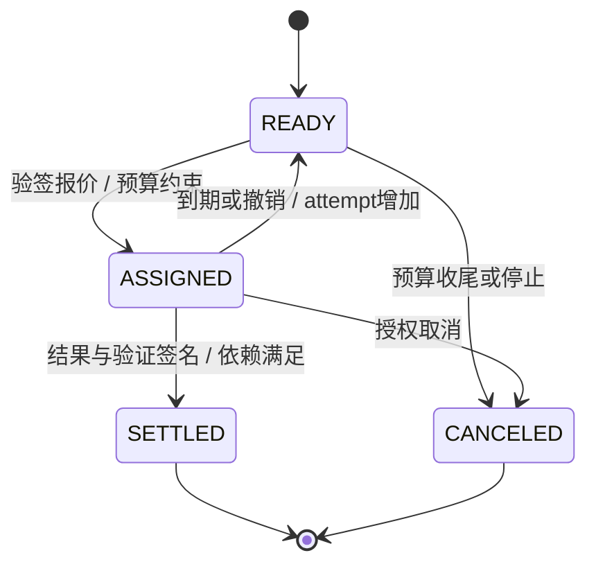
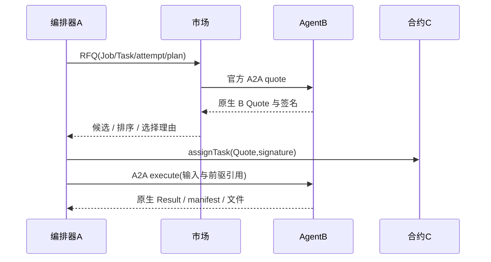
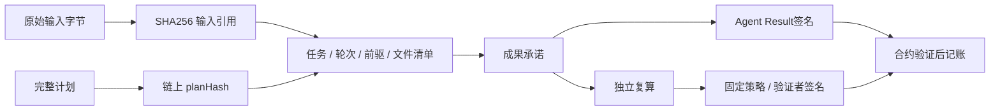
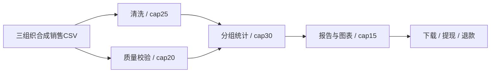
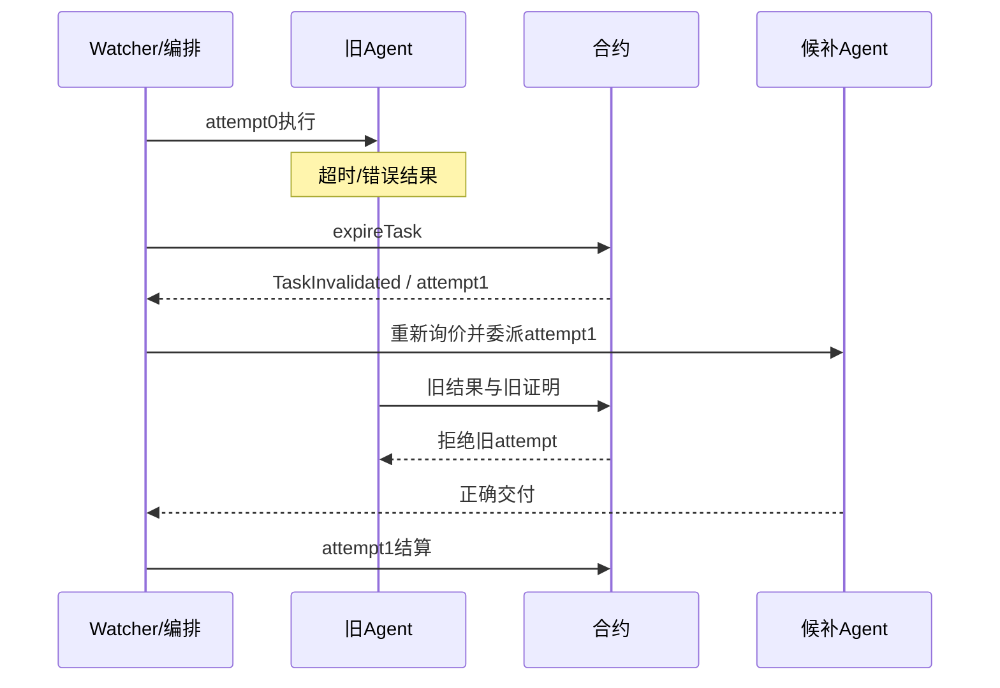
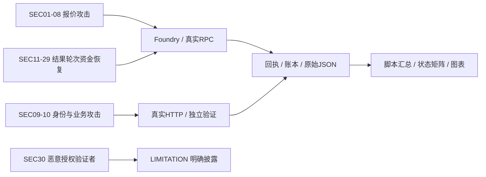

# AgentFlow Pay 统一系统设计报告

## 1 背景、问题与目标

不完全互信的服务商分别承担有依赖的子任务，普通单笔托管难以约束上游履约、执行轮次与多节点预算。系统将任务编排、独立服务报价、客观验证与资金条件分离，用链上约束保障可表达的身份、依赖、轮次与会计安全。跨组织仅表示服务主体独立；样例使用合成数据，没有宣称接入真实机构。

## 2 需求与范围

以 docs/requirements-v3.1.md 为需求基线，覆盖 R-01～R-10、G-01～G-10、S1～S6、SEC-01～30、INV-01～08。P0 通用 DAG、真实 A2A 竞价、签名交付、规则验证、托管结算、退款和真实超时恢复均由可运行脚本验收；P1 实现旅游复用及风险感知选择。可选双验证者和 P2 任意任务/自动代码/跨链/仲裁不纳入已实现声明。需求追踪表与实际结论见 requirements-traceability.md、测试报告.md。

## 3 参与者与信任边界

用户指定托管、协调者、固定验证策略及验证者；Agent 控制自己的签名钱包；协调者选择报价并提交凭证，不能指定任意收款人。授权验证者执行独立规则并签名，但链本身无法判断原始数据与主观质量。

## 4 总体架构与工程结构

apps/web 为原生前端；services/orchestrator/application.py 为统一编排实现，planner/scheduler/recovery/api 提供明确导出入口；services/agents 与 marketplace 保留并实际复用 B 的业务与签名对象；services/chain_adapter 提供 C 的独立交易客户端。contracts/src 只有一份权威合约；GitHub 主仓库不保留根目录重复的 .sol/.tsx 入口，app.py 保留导入兼容性。原 C 的嵌套 src 已展开。原模块文件完整性由 provenance/source-manifest.json 与四个 tar 保证。

部署进程为市场、独立验证器、6 个服务 Agent 与 API/Web 共 9 个业务进程；本地链独立运行。每个角色独立钱包，API 只持 owner/coordinator，验证器与 Agent 各自持有其私钥。managedRoles/wallets 支持角色分机部署，统一协议指纹和端点白名单限制错误混接。

## 5 DASC 协议详细设计

所有签名共用 services/chain_adapter/signing.py 的 TYPES。域为 DASC/1、实际 chainId 与 verifyingContract；taskId:uint8、attempt:uint32、时间:uint64，Attestation.verdict 为 bool。Quote 绑定 Job/Task/轮次/钱包/金额/需求/代币/期限/nonce；Result 绑定 Job/Task/轮次/钱包/内容与 URI 哈希/提交时间；Attestation 再绑定结果、验证策略、判定、期限与 nonce。

C 原 createJob ABI 保持兼容。统一系统使用 createBoundJob，一次交易冻结完整 planHash 和指定 validator；后续报价、执行及验证逐项比较不可变条款。任务按拓扑序登记，只允许向前依赖。结算要求依赖已在链上 SETTLED。

总资金满足 deposited = withdrawn + refunded + contractBalance，contractBalance = available + pending。报酬按 Job/Agent 保留 credits；withdraw(jobId) 有界领取，旧 withdraw() 汇总领取仍同步更新所有 Job 的审计账。终态 Job 才能 finalize，退款仅归 owner。requestStop 阻止后续委派，允许已接受委派在原窗口内完成，取消后继节点后退还余额。

## 6 多 Agent 协作、动态市场与选择

Agent 发布官方 A2A Card，注册时市场对端点发送随机挑战，核验 claimed wallet 对端点及 CardHash 的 EIP-191 签名。定期签名心跳控制租约；显式下线暂停心跳，重新注册后恢复。RFQ 对同技能实例并行发真实 A2A 请求；A 再核验报价、白名单及登记绑定。

最低价和风险感知均采用精确整数/分数；正式风险历史从规范链上 assignment/settled/invalidated 事件重建，Beta(1,1) 先验显式处理未知服务，不信任自报声誉。修复 B 原评分公式把成功率高的服务反向罚分的问题。该评分是启发式，不承诺统计上优于最低价。

## 7 成果、哈希与独立验证

文件原始字节采用 SHA-256；plan 为规范 JSON SHA-256；SDK 模式实际复用 B 的排序 JSON+Keccak 成果编码。A 保留 B 原签名与编码，不代签交付。manifest 绑定完整需求、输入引用、前驱轮次/哈希和成果引用；验证器从头复算清洗行守恒、质量清单、分组统计与报告引用，旅游则复核快照来源、预算、营业时间、移动及行程约束。

## 8 两个业务场景

旅游采用景点与酒店并行、路线规划、行程报告四节点；只换技能、输入和验证策略，同一调度循环与同一合约执行，没有在通用调度器增加旅游分支。旅游资料是带日期/来源的快照，不宣称实时价格或预订。scenarios/*.yaml 为人可读配置，API 也支持完整 configured_dag，要求输入哈希与预算一致。

## 9 实现功能、指标与证据

6 实例、至少四种主场景技能、双候选、4 节点含并行根；单 Job 最多16节点。tests/e2e/run_main_scenario.py 每轮启动新链/服务并运行正常和超时恢复，保存实际回执、报价、成果及余额；10轮重复实验满足 G-06。run_platform_acceptance.py 补注册冒用、坏成果、动态下线、SSE、API 强制退出恢复和停止退款。测得数字以测试报告和原始结果为准。

## 10 软件流程、异常处理与恢复

SQLite checkpoint 与事务 outbox 在发交易前持久化意图和确切参数，交易日志保存原始签名交易，重启按交易哈希/规范回执重放与对账。API 重启扫描非终态 Job，Agent 对幂等键持久化结果，不能把重试变成第二次有效付款。所有资金事实从合约读取；固定区块快照和事件重扫可检测本地重组，但不声称提供公链深重组最终性。

## 11 安全分析、实验与成本

全部合约测试包括重入、fuzz 与8项 invariant；正式系统扩展另测跨 Job 提现、固定验证者、计划不可覆盖和停止收尾。Gas 对比只比较测试中同目标生命周期的实际执行成本，不把成本增加描述成提升。攻击矩阵逐项区分 PASS/FAIL/SKIP/LIMITATION，不能将已授权验证者作恶计为防御成功。

## 12 局限与后续方向

当前是单管理员本地标准测试代币系统，未实现多租户、浏览器个人钱包、双验证者或争议仲裁。配置模板是明确兜底，没有声称任意自然语言大模型规划。源码提供 Docker/Besu，但其本次实际状态单列于测试报告。将来扩展应保持签名域、不可变策略、会计不变量和跨层证据一致。

主仓库整理说明：完整原始证据、历史模块文档与 provenance/*.tar 已从主仓库分离，保留为独立发布材料；相对路径仍表示其在证据包中的原路径。主仓库保留统一文档及 docs/verification 的验收摘要。详见 [GitHub 与发布材料](github-distribution.md)。
