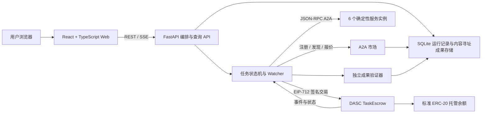
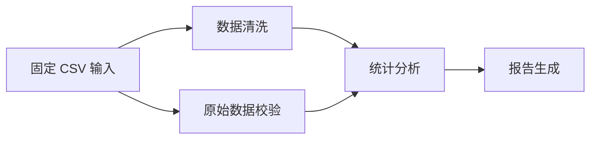

# AgentFlow Pay 系统设计报告

## 摘要

AgentFlow Pay 将跨组织数据任务表示为带依赖、预算和时限的有向无环图（DAG），通过 A2A 服务市场选择执行者，以链上托管合约记录任务授权和条件结算。系统把任务规划、服务发现、业务成果验证和资金状态分开：编排服务决定任务何时可执行，Agent 钱包签署报价与结果，独立验证器复算成果，DASC 合约检查签名、依赖、轮次和余额后记账。

本报告描述 `Dmodule` 当前集成代码的结构和约束。它不把尚未执行的浏览器、链上或性能检查表述为已验证结果；测试状态以[测试报告](测试报告.md)和对应原始证据为准。

## 1. 背景与目标

多组织协作任务通常需要多个独立服务商完成相互依赖的子任务。单一的“买家—卖家—一次付款”模型难以表达并行任务、上游成果依赖、超时后重委派、旧执行者失效以及有限托管资金下的多笔条件付款。

本系统希望把这些规则变成可检查的状态转移：

- 用户可预览计划、输入资料哈希和任务预算，再创建 Job。
- 独立 Agent 可运行时注册，按技能提交带钱包签名的报价。
- 无依赖或依赖已结算的节点可执行；互相独立的节点可并行。
- 业务验证器复算结构化成果，合约再核对 Agent 结果签名和授权验证者证明。
- 超时任务失效当前 attempt 后重新报价；旧 attempt 不得领取报酬。
- 报酬、退款、提现和链上事件可以按 Job/Task 追溯。

## 2. 系统结构

根目录中，`app.py` 实现数据模型、DAG、API、服务市场、A2A Agent、验证器、运行状态、恢复和链适配；`web.tsx` 提供任务、报价、状态、账本和成果页面；`TaskEscrow.sol` 与 `MockUSDC.sol` 提供合约和本地测试代币。`project.json` 固定服务配置、依赖和构建参数；`manage.py` 安装、构建、配置、检查、汇总和启动项目。

六个服务实例为 `clean-a`、`clean-b`、`quality-a`、`stats-a`、`stats-b` 和 `report-a`。实例通过配置声明技能和报价，不在 DAG 调度器中指定某个技能必须由固定实例执行。应用运行数据和成果文件放入独立 runtime 目录；密钥仅由环境变量提供。

## 3. 业务场景与 DAG

### 3.1 跨组织数据分析

主场景包含四个任务：

数据清洗和原始校验互不依赖，可并行运行；统计分析须等待二者链上结算；报告须等待统计结果。每个任务固定输入引用、需求哈希、验证策略、预算上限、执行窗口和最大 attempt 数。

### 3.2 旅游规划

旅游场景使用同一通用 Job/Task、Agent 市场、A2A、成果验证与结算流程：景点检索和住宿筛选并行，路线规划消费两者结果，行程报告消费已验证行程。旅游资料为带日期和来源的 JSON 快照，规划器只对该快照中的价格、开放时间和交通边进行确定性检查，不声称提供实时行情或预订。

旅游场景的固定合成输入位于 `tests/fixtures/travel/travel.json`。本地规则测试可独立验证行程和报告结构；跨 API、A2A 与链上运行须执行 `python manage.py run-travel`，当前链上运行证据状态见测试报告。

## 4. 协议与资金状态

### 4.1 创建与委派

1. API 对输入和计划进行校验，返回计划哈希及节点预算。
2. 创建 Job 时，owner 将固定数量的标准 ERC-20 转入 `TaskEscrow`；合约拒绝预算总额超过托管额、空配置和非法前向依赖。
3. 市场读取 Agent Card，检查端点白名单和 A2A 1.0 接口，并向端点发出绑定当前钱包、端点、Card 哈希和随机 nonce 的注册挑战。Agent 需用对应钱包签名。
4. 市场只返回技能匹配、租约有效且报价签名与注册钱包一致的候选者。协调者将签名 Quote 提交给合约；合约检查 EIP-712 域、Job、Task、attempt、价格、需求哈希、支付代币、期限和 nonce。

### 4.2 成果验证与结算

Agent 返回签名 Result 和成果清单。运行服务验证输入引用、产物哈希、业务规则和上下文；有效后，授权验证者对 Job、Task、attempt、结果哈希、验证策略、verdict、时限及 nonce 签署 Attestation。`settleTask` 仅在执行者、验证者、轮次、时限、依赖、预算与任务状态全部匹配时，把报酬记为该钱包的可提现余额。合约中的款项分为总可用余额和总待付余额，领取报酬和退款均为独立链上转账。

合约没有保存整个业务计划哈希或单 Job 提款记录：它按任务校验 `requirementHash` 与 `validationPolicyId`；钱包级 `withdraw()` 可能汇总多个 Job 的可提现余额。页面因此不把钱包级提现错误拆分到某个 Job。

### 4.3 超时恢复

任务超时后，Watcher 调用 `expireTask` 使当前 attempt 失效并递增轮次。市场重新收集候选报价，协调器按恢复策略委派新的 Agent。旧 attempt 的 Result 或 Attestation 不符合链上当前状态，不能再次结算。依赖节点未在链上结算之前，下游节点不能收款。

## 5. 数据与事件来源

浏览器通过 REST 获取计划预览、Job 快照、Agent、签名报价、成果和结算记录，通过 SSE 收取状态更新。与资金有关的确认必须核对交易回执和合约事件；数据库中的 checkpoint 只用于协调和恢复，不独立代表链上付款成功。

任务与资金的追踪主键为 `jobId`、`taskId` 和 `attempt`，并关联 `quoteHash`、`resultHash`、`txHash`。成果以内容哈希存储，下载时重新核对摘要。事件读取从配置的部署区块开始，并按确认区块头重扫；此实现不声称处理任意深度的公链重组最终性。

## 6. 威胁模型与信任边界

系统假设 EVM、ECDSA/EIP-712、指定标准 ERC-20 和私钥安全可用。Agent 可提交篡改报价、伪造身份、错误成果、重放旧凭证或超时迟交；合约和市场分别检查签名身份、业务上下文、attempt、依赖和预算。协调者可能拒绝服务或在授权范围内选择不理想服务，但不能绕过合约资金规则。

独立验证器只证明可重算的客观规则，不证明主观质量。拥有 `VERIFIER_ROLE` 的验证者仍能对不合格成果签署错误通过证明；P0 不可自动识别这一恶意决定。测试报告将其记为 SEC-30 `LIMITATION`，而不是防御通过。合约仅承诺适用于标准、无手续费、非 rebasing 的 ERC-20，不宣称兼容任意恶意代币。

## 7. 可复现性与实现限制

`python manage.py test-e2e` 执行 10 轮数据分析正常/恢复流程；`python manage.py run-travel` 执行一次旅游场景正常/恢复流程；`python manage.py test-security` 运行 Foundry 测试并生成 SEC-01 至 SEC-30 案例状态；`python manage.py collect-results` 从原始 JSON 重算 CSV/JSON 摘要。测试报告列出本机和基线 CI 的实际验证边界。

交互式应用 `start` 仍使用部署环境提供的 RPC、代币和托管合约；本仓库不会自动为日常 Web 服务生成钱包或连接真实资产。隔离 E2E 脚本会自行启动临时 Anvil、部署本地测试合约和启动服务，但不等同于干净电脑上的浏览器部署验收。多租户账户体系、浏览器钱包签名、自然语言任意规划、实时旅游数据、浏览器自动化、性能对比和随机状态 invariant 均未由本报告宣称完成。
