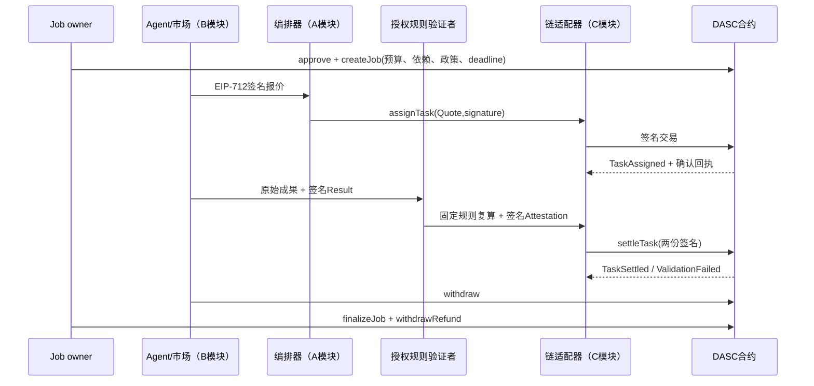
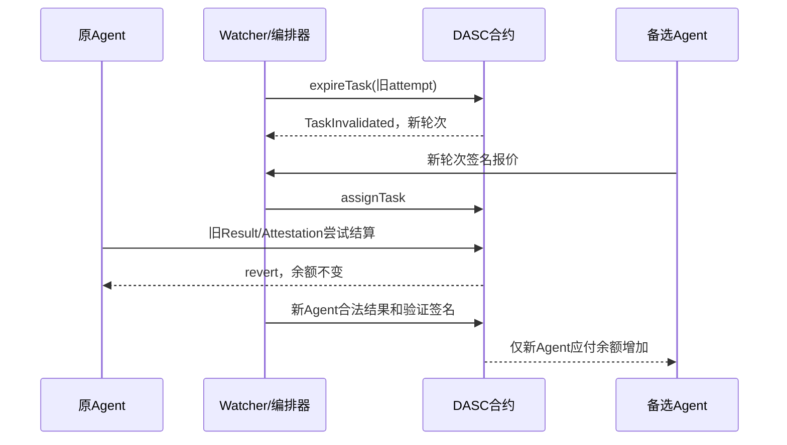

# AgentFlow Pay 设计报告 — C 模块章节素材

本文件按《第三版.md》的报告责任提供第 3、5、7、10、11 章素材。A 统稿其他章节；本文不声称完整平台全部实现。

## 第 3 章：设计目标与协议创新

独立服务 Agent 的任务存在依赖、重试和多笔报酬，普通单笔托管没有天然表达这些约束。本模块将报价承诺、交付承诺、授权验证、执行轮次、依赖和总预算统一作为付款条件。

S1～S6 的定义和对应实现见 `dasc-protocol.md`，资金不变量见 `contracts/test/invariant/AccountingInvariant.t.sol`。创新在约束组合和可验证行为，不把 EIP-712、ECDSA、ERC-20、QBFT 等既有技术视为原创。

## 第 5 章：核心协议详细设计

Job/Task/Quote/Result/Attestation 的格式与函数表见 `contract-interface.md` 和 `packages/schemas/`。链上 Job 最多 16 个任务，依赖只允许指向小编号节点，因此低成本拒绝自依赖和环。

执行前可委派下游任务，但付款严格等待上游已结算，体现并行准备与安全结算的取舍。报价与验证 nonce 按签名钱包分别全合约消费。结果内容只存哈希；原始数据链下保存。

## 第 7 章：成果验证与信任模型

C 的确定性统计夹具以固定整数输入复算 count、sum、mean，并固定 stat_v1 政策。完整业务策略由 A 提供。结果哈希承诺字节一致，验证者签名证明批准；二者都不能保证现实数据来源真实。

SEC-30 使用错误 sum=999 和真实授权签名展示仍会支付，同时客观复算指出错误。该例用于明确 P0 信任缺口，不作为“防御成功”。双验证者与争议期属于 P1，当前未实现。

## 第 10 章：资金流程与异常处理

正常付款为拉取式：SETTLED 增加 withdrawable，Agent 再领取报酬。remaining、withdrawable 与 refundable 分账，退款不侵占已确认报酬。

验证失败可重派；重试耗尽取消并传播依赖。Job 总截止时间保证未委派任务也可 permissionless 收尾。协调器重试不能修改链上已付款事实。

链适配器在发送前保存签名原始交易，恢复时重发同一交易。重复请求 ID 不产生第二笔交易；重复业务提交仍由合约唯一结算约束阻止。事件游标重扫、去重及区块哈希检查帮助链下状态恢复。

## 第 11 章：可靠性、安全与取舍

合约使用 OpenZeppelin；开发测试使用 Foundry fuzz/invariant。部署兼容 Anvil 与 Besu QBFT；后者采用 4 验证节点＋1 RPC 节点。故障实验验证单验证节点停止时继续出块、恢复节点追链。

所有节点目前运行在同一主机，不能推导出真实组织独立治理或物理隔离。默认 RPC/管理员/验证者受信，风险详见 `threat-model.md` 和 `security-assumptions.md`。

简单托管基线仅是自行实现的对照，不代表行业通用托管安全性。Gas 对比测量同样的一任务托管/付款/退款路径，并说明 DASC 额外提供的签名、策略、轮次和预算约束；数值由实际 snapshot 生成。

## 需求—实现—测试追踪

| 要求 | 实现 | 测试 |
|---|---|---|
| R-03 报价身份/金额 | TaskEscrow + signing.py | SEC-01～08；Python/Solidity digest |
| R-04 结果哈希/轮次 | settleTask | SEC-11～15、20～21 |
| R-05 依赖 | 拓扑登记、settledMask | SEC-17/18、INV-06 |
| R-06 恢复与旧轮次 | expire/revoke、expire_due_tasks | SEC-14～16、INV-05 |
| R-07 资金安全 | 预算冻结、分账、拉取提现 | SEC-22～29、INV-01～04/07 |
| R-10 信任边界 | 固定政策、授权签名、明确限制 | SEC-19～21、SEC-30 |

真实 A2A 身份、业务规划和完整场景需要 A/B/D 接入。最终完成状态和实测数据引用 `测试报告.md`。
